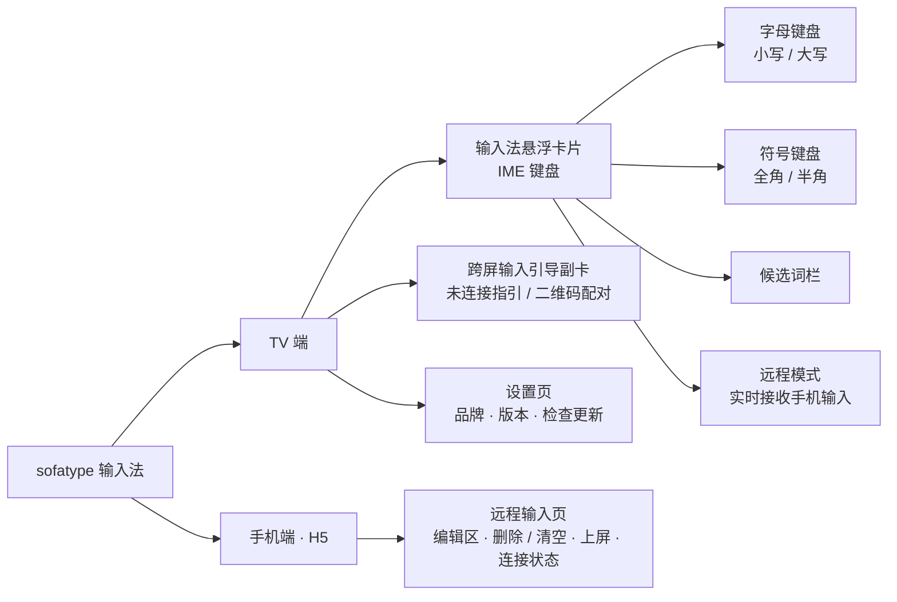
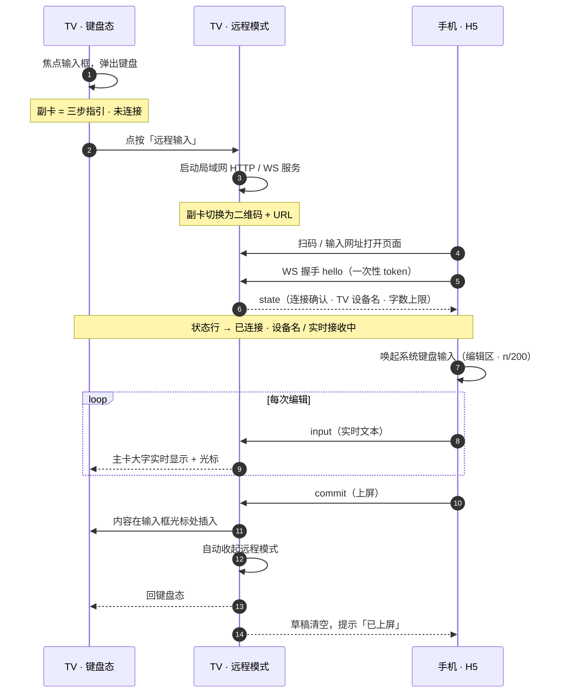
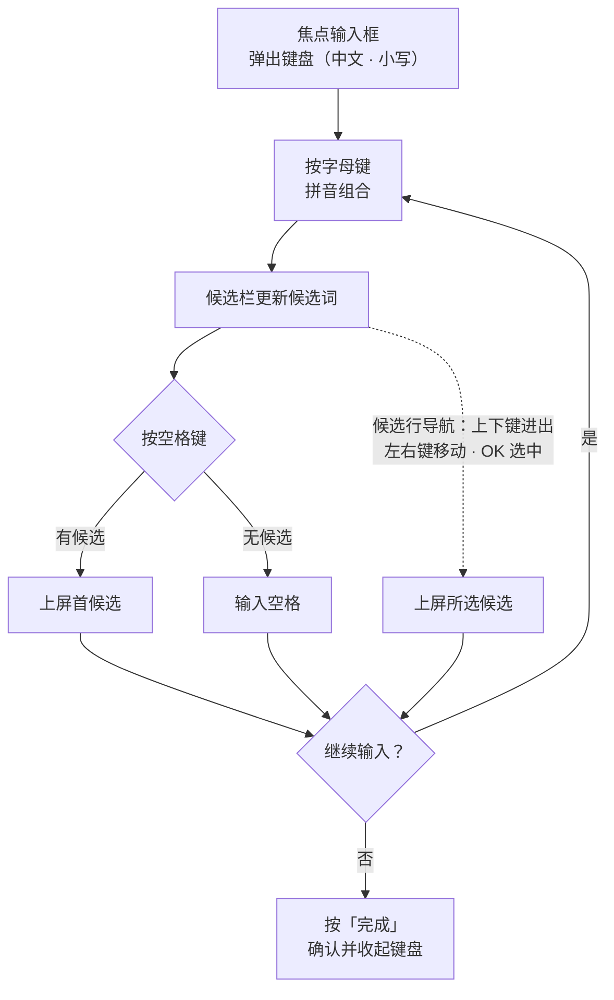

# sofatype 输入法 · 产品需求文档（PRD）

| 项目 | 内容 |
| --- | --- |
| 产品名称 | sofatype 输入法（Android TV 输入法 + 跨屏输入） |
| 文档版本 | v1.1（评审修订稿） |
| 文档日期 | 2026-11-01 |
| 文档状态 | 第 1 轮评审结论已合入（决策 R-1~R-6 已拍板，见第 12 章） |
| 依据资料 | `designs/tv-ime-crossscreen/`、`designs/phone-remote-input/`、`designs/ime-settings/`、`designs/color-schemes/` |
| 目标平台 | Android TV / 智能电视盒子（TV 端），手机浏览器 H5（手机端） |

---

## 1. 产品概述

### 1.1 背景与问题

在 Android TV / 电视盒子上通过遥控器方向键逐个选择字母进行输入，效率极低；中文拼音输入在电视上更是普遍痛点。搜索片名、输入账号密码、填写 Wi-Fi 密码等场景下，用户输入成本高、极易放弃。

### 1.2 产品定位

sofatype 是一款运行在 Android TV 上的第三方输入法（IME），包含两个协同的端：

1. **TV 端输入法**：悬浮卡片式键盘，支持中英文、大小写、全角/半角符号，可用遥控器完成全部输入；
2. **跨屏输入（远程输入）**：TV 端出示二维码，手机扫码后打开网页版输入器，手机上打的字实时显示在电视上，点「上屏」一键写入电视输入框——把手机变成电视的键盘。

辅以一个 TV 端**设置页**（品牌展示、版本信息、检查更新），三端统一使用「星夜青 Aurora Cyan」全深色视觉体系。

### 1.3 产品目标

- 遥控器可独立完成字母、数字、中英文、全/半角符号的完整输入，无操作死角；
- 扫码后 3 秒内手机即可开始为电视打字，编辑内容实时可见、一键上屏；
- 三端视觉与交互一致，暗色环境下舒适、品牌辨识度高。

### 1.4 非目标（本期不做）

- ❌ 语音输入（评审中已明确移除，候选栏不出现语音入口）；
- ❌ 候选栏中显示拼音串（评审决策：只显示候选词）；
- ❌ 云端账号、云词库同步（本期输入全部本地/局域网完成）；
- ❌ 除「星夜青」以外的配色方案（目录名 `P1-Cyan` 表明后续会扩展多配色，本期仅落地一套，见开放问题 O-5）；
- ❌ iOS / Android 原生 App（手机端为纯网页 H5，扫码即用）。

---

## 2. 用户与场景

### 2.1 目标用户

| 角色 | 说明 | 主要操作设备 |
| --- | --- | --- |
| TV 用户 | 在电视上搜索、登录、填密码的人；即手机用户本人 | 遥控器（十字键 + OK + 返回） |
| 手机用户 | 与 TV 用户为同一人；通过系统相机扫码打开 H5 页 | 手机（系统键盘，含其自装中文输入法） |

### 2.2 核心场景与用户故事

- **S1 追剧搜索**：想搜《客庭的故事》，用遥控器在字母键盘上按出拼音 `keting`，候选栏给出「客厅的 / 客厅 / 客 / 科」，选词上屏。
- **S2 长文本输入**：需要输入复杂的 Wi-Fi 密码/账号，按「远程输入」，电视出示二维码；手机扫码打开「远程输入」页，用手机键盘打字，电视左侧卡片实时显示；点「上屏」写入电视输入框。
- **S3 符号输入**：输入邮箱时用 `@`、`.com` 快捷键；输入密码时切到符号键盘，并用「全/半」键在中文全角与英文半角符号间切换。
- **S4 版本维护**：用户进入系统设置中的 sofatype 输入法设置页，查看当前版本，按 OK 键「检查更新」。

---

## 3. 产品结构

三端共享同一套设计系统「星夜青」（见第 6 章）。

---

## 4. 功能需求

优先级定义：**P0** = 首版必须；**P1** = 首版尽量 / 紧随其后；**P2** = 后续版本。

### 4.1 TV 输入法键盘（FR-A）

键盘为悬浮卡片形态（方案 B · 悬浮卡片），叠加于当前应用内容之上，不整屏跳转。

| 编号 | 需求 | 说明 | 优先级 |
| --- | --- | --- | --- |
| FR-A1 | 键盘唤起与收起 | 在可输入焦点处确认后弹出键盘悬浮卡片；点「下屏」键或系统返回键收起键盘，不丢失已输入内容 | P0 |
| FR-A2 | 键盘布局 | 键盘悬浮层（主卡片约 1272×548 + 右侧副卡 472×548，见 FR-B1）**整体停靠于屏幕底部**，覆盖高约 644px，不遮挡上部内容区（评审结论 R-1）；主卡片上部为候选词栏，下部为 4 行键盘：左侧数字列（1-0、.com、@），中部字母区（a-z），右侧功能键区 | P0 |
| FR-A3 | 大小写切换 | 「上档」键在小写/大写间切换；大写态时该键态提示变为「大写已开启，点按切回小写」，字母区全部显示大写 | P0 |
| FR-A4 | 中/英切换 | 「中/英」键切换中文/英文模式；英文模式按键直出字母，中文模式按键进入拼音组合并产出候选词 | P0 |
| FR-A5 | 符号键盘 | 「123_!」键进入符号键盘；符号键盘**没有**大写键与中/英键（评审决策），仅有「全/半」切换键；「返回」键回到字母键盘 | P0 |
| FR-A6 | 全角/半角符号集 | 全角：～ ！ ＃ ￥ ％ …… ＆ ？ （ ） —— ＋ ＝ × ； ： ‘ ’ “ ” ， 。 ／ ＊ 「 」 《 》 ｜ ＼；半角：~ ! # $ ^ % & ? ( ) _ - + = ; : ' " , . / * [ ] { } \| \\ | P0 |
| FR-A7 | 候选词栏 | 仅展示候选词 chips（不显示拼音、不显示语音入口）；首候选高亮（青色描边 chip），其后依次排列；候选行支持遥控器焦点进入（上下键进出候选行、左右键在候选间移动、OK 选中上屏，评审补充）；英文/数字模式下候选栏隐藏、键盘区上移占满主卡片（评审补充）；右侧「更多 ⌄」展开更多候选（FR-A15） | P0 |
| FR-A8 | 中文输入引擎 | 拼音组合 → 候选词列表（整句/词组/单字混合排序），选词上屏；组合态空格键：有候选时选首候选，无候选时输入空格（评审结论 R-2）；候选由本地词库产生，无网络依赖 | P0 |
| FR-A9 | 特殊键 | 空格、删除（退格）、`.com` 快捷上屏、`@` 直出；左/右光标键在输入框内移动光标 | P0 |
| FR-A10 | 完成键 | 「完成」键确认当前输入并收起键盘（键位为跨两行的高键，青色描边样式） | P0 |
| FR-A11 | 遥控器焦点导航 | 十字键在键位间移动焦点，OK 确认；焦点态 = 主色描边 + 微高亮底（见 6.4）；焦点移动路径符合视觉行列关系，不跳变 | P0 |
| FR-A12 | 长按连删 | 删除键长按连续删除，先慢后快 | P1 |
| FR-A13 | 键盘记忆 | 记住上次的中/英、大写锁定、全/半角状态（按会话） | P2 |
| FR-A14 | 按键振动/音效反馈 | 遥控器按键触发轻量触感/音效（系统设置可关） | P2 |
| FR-A15 | 更多候选展开 | 点「更多 ⌄」在候选栏下方展开第二行候选（分页展示、左右翻页），再次点按收起；展开行同样支持焦点导航（首轮评审补充） | P0 |

### 4.2 跨屏输入 · TV 端（FR-B）

| 编号 | 需求 | 说明 | 优先级 |
| --- | --- | --- | --- |
| FR-B1 | 跨屏输入引导副卡 | 键盘态右侧副卡常驻：标题「跨屏输入」+ 图标；状态行（未连接 = 灰点，已连接 = 绿点 + 设备名）；三步指引文案：① 手机与电视连接同一 Wi-Fi ② 点按「远程输入」出示二维码 ③ 手机扫码，即可远程打字；底部「远程输入」主按钮；按钮下提示「进入后：左侧显示手机输入内容，此卡变为二维码」 | P0 |
| FR-B2 | 进入远程模式 | 点「远程输入」后：主卡片切换为远程模式（FR-B3），副卡切换为二维码配对卡 | P0 |
| FR-B3 | 远程模式主卡 | 状态行：绿点 + 「实时接收中」 + 「来自 · <设备名>（位置）」，右侧「退出远程」按钮；卡片中部以大号文字（40px）实时显示手机输入内容，末尾青色光标；底部提示「在手机上打字，内容将实时显示在这里；手机端点『上屏』后写入电视输入框」 | P0 |
| FR-B4 | 二维码配对卡 | 副卡整卡显示配对二维码（376×376，圆角 38）及下方访问地址一行（如 `http://192.168.1.210:32923/`），地址与二维码内容一致；二维码下方不再显示其他文案（评审决策） | P0 |
| FR-B5 | 实时同步 | 手机端每次编辑在 300ms 内（局域网）反映到 TV 远程模式主卡；内容超出显示宽度时滚动展示末尾内容 | P0 |
| FR-B6 | 上屏写入 | 收到手机「上屏」指令后，将内容在电视输入框**光标处插入**（不覆盖输入框其余已有文字；若存在选中区间则替换该区间），随后**自动收起远程模式、回归键盘态**（评审结论 R-3/R-4）；上屏成功后手机端草稿清空并给出「已上屏」提示 | P0 |
| FR-B7 | 退出远程 | 「退出远程」按钮或系统返回键退出远程模式，关闭 HTTP/WS 服务监听，回到键盘态；已接收未上屏内容按丢弃处理并给出提示 | P0 |
| FR-B8 | 断连处理 | 手机关闭页面 / Wi-Fi 断开时：TV 端状态行提示连接已断开并回到引导态；手机端显示断连提示，支持刷新重连 | P0 |
| FR-B9 | 连接状态展示 | 副卡状态行三态：未连接（灰点）/ 等待扫码（青点 + 「等待手机扫码」）/ 已连接（绿点 + 设备名，如「已连接 · 小米手机（客厅）」） | P0 |
| FR-B10 | 配对安全 | 二维码 URL 携带一次性配对 token，配对成功后 token 失效；服务仅监听局域网接口 | P0 |
| FR-B11 | 多手机互斥 | 同一时间仅允许 1 台手机保持连接；新手机连接成功时**自动替换旧连接**，旧手机收到「连接已被替换」提示并进入未连接引导态（评审结论 R-5） | P1 |
| FR-B12 | 会话恢复 | 手机端页面意外刷新后，在有效期内可自动恢复会话与未上屏内容 | P2 |

### 4.3 跨屏输入 · 手机端 H5（FR-C）

页面基准尺寸 390×844（适配各类手机屏幕，竖屏单页，无滚动或最小滚动）。

| 编号 | 需求 | 说明 | 优先级 |
| --- | --- | --- | --- |
| FR-C1 | 打开方式 | 手机扫码或输入 TV 显示的 URL 打开；支持系统浏览器及微信等内置浏览器内核 | P0 |
| FR-C2 | 页面结构 | 自上而下：标题「远程输入」；状态行（绿点 + 「已连接 · <TV 设备名>」｜竖分隔线｜电视图标 + 「文字将实时显示在电视上」，紧随标题下方左对齐——评审决策）；编辑卡片；删除 / 清空 双按钮；「上屏」主按钮；页脚「同一 Wi-Fi 下与电视保持连接」 | P0 |
| FR-C3 | 编辑卡片 | 卡片内为已输入内容 + 末尾光标；点击卡片唤起手机系统键盘（用户可使用其自装中文输入法）；右上/右下角显示字数 `n / 200` | P0 |
| FR-C4 | 实时推送 | 每次编辑（输入/删除/清空）立即推送到 TV，TV 端实时显示 | P0 |
| FR-C5 | 删除 / 清空 | 「删除」移除末尾 1 个字符；「清空」清空全部内容（清空前无需二次确认，内容同时从 TV 端移除） | P0 |
| FR-C6 | 上屏 | 「上屏」将当前全部内容写入电视输入框（FR-B6，光标处插入）；内容为空时按钮置灰不可点；成功后草稿清空并提示「已上屏」（评审补充） | P0 |
| FR-C7 | 字数上限 | 单次远程输入上限 200 字符，达到上限后停止接受输入并轻提示 | P0 |
| FR-C8 | 断连提示 | 与 TV 失去连接时显示断连状态与「重连」入口；重连失败给出引导（检查同一 Wi-Fi、重新扫码） | P0 |
| FR-C9 | 未连接态 | 直接输入 URL 但扫码上下文失效/超时时，展示未连接引导页（提示重新扫码） | P1 |
| FR-C10 | 历史记录 | 保留最近若干条已上屏内容，可一键重新填入 | P2 |

### 4.4 TV 设置页（FR-D）

| 编号 | 需求 | 说明 | 优先级 |
| --- | --- | --- | --- |
| FR-D1 | 入口与面包屑 | 从系统输入法设置/应用入口进入；页面左上角面包屑「sofatype 输入法 ｜ 设置」 | P0 |
| FR-D2 | 品牌区 | 页面居中：品牌 Logo（88×88 圆角方块，青底 + 深青「S」）+ 「sofatype」字标；下方副标题「输入法 · 设置」 | P0 |
| FR-D3 | 版本信息卡 | 展示「当前版本 v1.2.3 (63)」格式：版本号 + (build 号)；卡片下部为「检查更新」按钮与检查结果状态 | P0 |
| FR-D4 | 检查更新 | 点按/OK 触发检查；结果态：① 绿点 + 「已是最新版本」② 发现新版本 → 显示新版本号与更新说明，OK 确认后进入下载（展示进度），完成后弹安装确认框（评审补充）③ 检查失败 → 红点 + 失败原因，可重试 | P0 / P1 |
| FR-D5 | 操作提示 | 页面底部提示「按遥控器 OK 键检查更新」，随焦点位置动态切换（P1：焦点落在其他控件时提示对应操作） | P0 / P1 |
| FR-D6 | 配色方案设置 | 多套配色下的主题切换入口；本期色值 Token 化预留但不露出入口（评审结论 R-6，O-5 关闭） | P2 |
| FR-D7 | 其他设置项 | 输入习惯（候选数量、按键反馈等）设置入口 | P2 |

---

## 5. 关键流程

### 5.1 跨屏输入配对流程（主流程）

### 5.2 遥控器输入流程（中文）

> 空格键在中文组合态：有候选时选首候选，无候选时输入空格（评审结论 R-2，O-2 已关闭）。

### 5.3 断连与异常

| 异常 | TV 端表现 | 手机端表现 |
| --- | --- | --- |
| 手机关闭页面/断网 | 状态行回到「未连接」，主卡回到等待扫码 | —（页面已不可达） |
| Wi-Fi 切换（不同网段） | 同上；二维码 IP 失效时自动重建服务并刷新二维码 | 「连接已断开」+ 重连引导 |
| TV 端退出远程 | — | 「电视已退出远程输入」提示，输入禁用 |
| 键盘进程被杀 | 下次唤起键盘回到未连接初始态 | 页面超时提示重新扫码 |

---

## 6. 设计规范 · 星夜青（Aurora Cyan）

全深色、青主色，三端一致。手机端由浅色改为深色青调（评审决策，见 `designs/color-schemes/`）。色值按下表以设计 Token 集中管理，本期不提供主题切换入口（评审结论 R-6）。

### 6.1 色彩 Token

| Token | 值 | 用途 |
| --- | --- | --- |
| `bg` | `#06080C` | 三端页面背景 |
| `card` | `#12161E` | 卡片/悬浮面板底色（描边 `rgba(255,255,255,.08)`，1~1.5px） |
| `key` | `#1D242F` | 键帽底色 |
| `key-hover` | `#242C39` | 键帽 hover/按压提亮 |
| `accent` | `#38BDF8` | 主色：强调键底色、品牌块、光标、上屏主按钮 |
| `accent-hover` | `#5BC9FA` | 主色 hover |
| `accent-text` | `#7DD3FC` | 主色上的文字/描边文字、焦点描边文字、URL |
| `on-accent` | `#052330` | 主色底上的深青文字（完成/删除强调键、S 标、上屏按钮） |
| `success` | `#34D399` | 连接成功/最新版本状态点 |
| `text-primary` | `#F2F6FB` | 主文字（标题、大字内容、品牌字标） |
| `text-body` | `#E8EEF5` | 键帽字符正文 |
| `text-secondary` | `#C9D4E2` | 功能键文字 |
| `text-muted` | `#7F848D` | 次级文字、说明文案 |
| `border-accent` | `rgba(56,189,248,.5)`（文字态 `.45`） | 主色描边（按钮/焦点/高亮 chip） |
| `accent-wash` | `rgba(56,189,248,.14~.16)` | 主色淡底（副卡按钮、候选高亮 chip、完成键） |
| `divider` | `rgba(255,255,255,.07~.15)` | 分隔线 |

### 6.2 字体

`Noto Sans SC`（兜底 `PingFang SC` / `Microsoft YaHei` / system-ui），权重 400 / 500 / 700 / 900。

### 6.3 控件规格（基准 1080p，4K 屏幕等比 2x）

| 控件 | 规格 |
| --- | --- |
| TV 键帽 | 80×92，圆角 14，字符 30px；功能键文字 22px |
| 候选 chip | 高 52，圆角 12，文字 28px；高亮态 = `accent-wash` 底 + `border-accent` 描边 |
| 悬浮卡片 | 圆角 38（平滑苹果式大圆角），底部柔影（黑 55% 模糊 30） |
| 副卡主按钮（远程输入） | 高 60，`accent-wash` 底 + `border-accent` 描边，文字 21px |
| TV 设置·检查更新按钮 | 196×64，圆角 14，`accent-wash` 底 + `border-accent` 描边，文字 19px |
| 手机次级按钮（删除/清空） | 165×56，圆角 14，`key` 底，文字 15px |
| 手机主按钮（上屏） | 342×56，圆角 16，`accent` 底 + `on-accent` 文字 17px 粗体 |
| 手机编辑卡 | 342×336，圆角 20，`card` 底 + `rgba(56,189,248,.4)` 描边 1.5px |
| 状态点 | 直径 8（TV）/ 8（手机），成功 `success`，未连接 `rgba(232,239,246,.35)` |

### 6.4 状态与焦点

- **焦点态（遥控器）**：主色描边 + 键帽提亮，即「聚焦态 = 主色描边」（设计稿注明）；
- **hover（鼠标/触控模拟）**：键帽 `key-hover`，主色元素 `accent-hover`；
- **连接状态色**：未连接 = 灰点，等待 = 青点（主色），已连接 = 绿点（`success`）。

---

## 7. 通信协议草案（跨屏输入）

传输：HTTP（下发页面）+ WebSocket（双向消息），均监听 TV 局域网地址。

**消息类型（JSON）**

| type | 方向 | 载荷 | 说明 |
| --- | --- | --- | --- |
| `hello` | 手机 → TV | `{ token, deviceName }` | 携带二维码中的一次性 token 完成配对 |
| `state` | TV → 手机 | `{ connected, tvName, charLimit }` | 连接确认与能力下发 |
| `input` | 手机 → TV | `{ text }` | 当前编辑区全量/增量文本（实时显示） |
| `cursor` | 手机 → TV | `{ index }` | 光标位置（P1） |
| `clear` | 手机 → TV | `{}` | 清空 |
| `commit` | 手机 → TV | `{ text }` | 上屏写入电视输入框 |
| `disconnect` | 双向 | `{ reason }` | 断连通知 |

安全要求见 FR-B10：token 一次性、仅局域网监听、配对后 token 失效。

---

## 8. 非功能需求

| 类别 | 需求 |
| --- | --- |
| 性能 | 键帽按下视觉反馈 ≤ 100ms；中文候选刷新 ≤ 200ms；手机编辑 → TV 显示端到端 ≤ 300ms（局域网）；扫码到手机页可输入 ≤ 3s |
| 兼容性 | Android TV 6.0+（minSdk 23；2026-11-02 拍板按验收实机口径调整，原「9.0+」作废，见第 12 章决策 13）；APK 须含 armeabi-v7a，首版验收基线设备为小米电视4 `MiTV4-ANSM0`（Android 6.0.1 / armeabi-v7a，见 `devices/`）；TV 分辨率 1080p 基准、兼容 4K 等比缩放；手机端支持 iOS Safari 14+、Android Chrome、微信内置浏览器 |
| 可靠性 | 输入法服务崩溃后可被系统重启且不阻塞宿主应用；远程服务随远程模式启停，退出后不残留监听端口 |
| 安全与隐私 | 按键内容仅在局域网内传输、本地处理，不上传云端；配对 token 一次性；不在本地持久化用户输入内容（含远程输入缓冲，会话结束即清除） |
| 无障碍 | 全部键位/按钮具备 `aria-label`（设计稿已标注：上档切换、下屏收起键盘、删除、光标左移/右移、进入远程输入模式、退出远程模式等）；焦点态满足对比度要求 |
| 电量与资源 | 键盘非激活时不占用 CPU；远程模式空闲（无手机连接）30 分钟自动退出并收起键盘（P1） |

---

## 9. 成功指标（首版上线后 30 天）

| 指标 | 目标 |
| --- | --- |
| 跨屏输入渗透率（唤起键盘用户中使用过远程输入的比例） | ≥ 25% |
| 扫码 → 连接成功率 | ≥ 95% |
| 扫码 → 首次成功输入耗时中位数 | ≤ 10s |
| 单次远程输入会话平均上屏字数 | ≥ 15 字（说明确实替代了遥控器打字） |
| 崩溃率（IME 进程） | ≤ 0.1% |

> 埋点仅记录事件计数与耗时，不采集输入内容本身（隐私要求见第 8 章）。

---

## 10. 里程碑

| 阶段 | 范围 | 对应需求 |
| --- | --- | --- |
| M1 · 键盘可用 | 悬浮卡片键盘：字母（大小写）、数字、符号（全/半角）、中/英、候选词、遥控器焦点导航、完成/收起 | FR-A1~A11 |
| M2 · 跨屏输入 | 引导副卡、二维码配对、远程模式主卡、手机 H5 页、实时同步、上屏、断连处理 | FR-B1~B10, FR-C1~C8 |
| M3 · 设置页与打磨 | 设置页、检查更新、长按连删、多手机互斥、无障碍标注补全 | FR-D1~D5, FR-A12, FR-B11 |
| M4 · 增强 | 会话恢复、输入历史、多配色、更多设置项 | FR-B12, FR-C10, FR-D6~D7, FR-A13~A14 |

---

## 11. 风险与开放问题

| 编号 | 类型 | 内容 | 建议 |
| --- | --- | --- | --- |
| O-1 | 开放 | 中文拼音引擎选型：自研整句引擎 vs 集成开源词库（如开源拼音词库方案） | M1 前技术预研，先用词组级引擎兜底 |
| O-4 | 风险 | 微信内置浏览器对 WebSocket/剪贴板等能力的兼容差异 | M2 兼容性测试覆盖微信内核，必要时降级轮询 |
| O-6 | 风险 | 部分 TV 网络 IP 变化导致二维码失效 | 二维码内容在服务启动时生成，IP 变化时自动重建并刷新二维码 |
| O-7 | 开放 | 远程输入 200 字上限是否合理（密码/地址场景足够，长文场景偏紧） | 上线后依据会话字数分布调整 |
| O-8 | 风险 | 跨屏输入走局域网明文 HTTP/WS，密码类内容存在同网段嗅探的理论风险（首轮评审新增） | 首版：一次性 token + 会话结束即清缓冲 + 文案提示敏感密码建议用遥控器输入；TLS 列入后续评估 |

> O-2（空格键行为）、O-3（上屏后行为）、O-5（配色框架）已在第 1 轮评审中拍板关闭，结论见第 12 章；编号不重排以免外部引用错乱。

---

## 12. 已确认的设计决策记录（评审结论）

以下决策已在设计评审中确认，实现时不再反复：

1. **候选栏不显示拼音串**，只显示候选词 chips（`designs/tv-ime-crossscreen/comments.json`）；
2. **不提供语音输入**入口；
3. **符号键盘**没有大写键、没有中/英切换，只有「全/半」切换键；「返回」键位于第二行，空格为跨两行高键，与完成键对称；
4. 远程配对卡**只保留二维码 + 网址一行**，不加其他文案；
5. 手机端状态行（已连接 · 设备名）**置于「远程输入」标题之后**左对齐；
6. 手机端采用**深色青调**（由浅色方案改为与 TV 一致的星夜青）。

以下为第 1 轮 PRD 评审（2026-11-01）新增结论：

7. 键盘悬浮层**停靠屏幕底部**，覆盖高约 644px，不遮挡上部内容（R-1）；
8. 中文组合态空格键：**有候选时选首候选，无候选时输入空格**（R-2，O-2 关闭）；
9. 「上屏」为**光标处插入**，不覆盖输入框其余已有文字（R-3）；
10. 上屏后**自动收起远程模式**回键盘态，手机端草稿清空并提示「已上屏」（R-4，O-3 关闭）；
11. 多手机策略：**新连接替换旧连接**，旧手机收到被替换提示（R-5）；
12. 多配色：本期色值 **Token 化预留、不露出切换入口**（R-6，O-5 关闭）。

以下为 2026-11-02 验收准备阶段新增拍板：

13. 兼容基线：首版按 **Android TV 6.0+（minSdk 23）** 执行，验收实机为小米电视4 `MiTV4-ANSM0`（Android 6.0.1 / armeabi-v7a，见 `devices/`）；原「Android TV 9.0+」表述作废，第 8 章已同步修订。

---

## 13. 附录 · 设计稿索引

| 设计稿 | 路径 | 内容 |
| --- | --- | --- |
| TV 输入法 · 跨屏输入 | `designs/tv-ime-crossscreen/` | 5 画板（1920×644）：① 字母键盘·小写 ② 字母键盘·大写 ③ 符号键盘·全角 ④ 符号键盘·半角 ⑤ 远程模式（含二维码） |
| 手机远程输入 | `designs/phone-remote-input/` | 1 画板（390×844）：远程输入页 · 星夜青 |
| 输入法设置 | `designs/ime-settings/` | 1 画板（1920×1080）：设置页 · 方案 A 品牌暗夜 |
| 三端配色 | `designs/color-schemes/` | 1 画板（1920×1080）：配色 1 · 星夜青（色板 + 三端示例） |
| 评审意见 | `designs/phone-remote-input/comments.json`、`designs/tv-ime-crossscreen/comments.json` | 已解决的设计决策（见第 12 章） |
