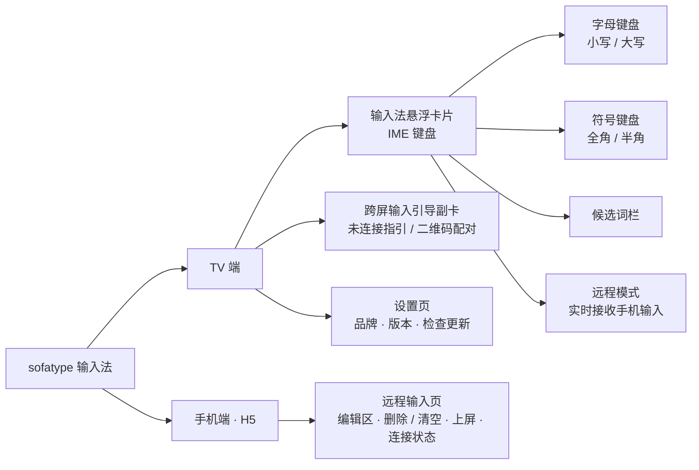
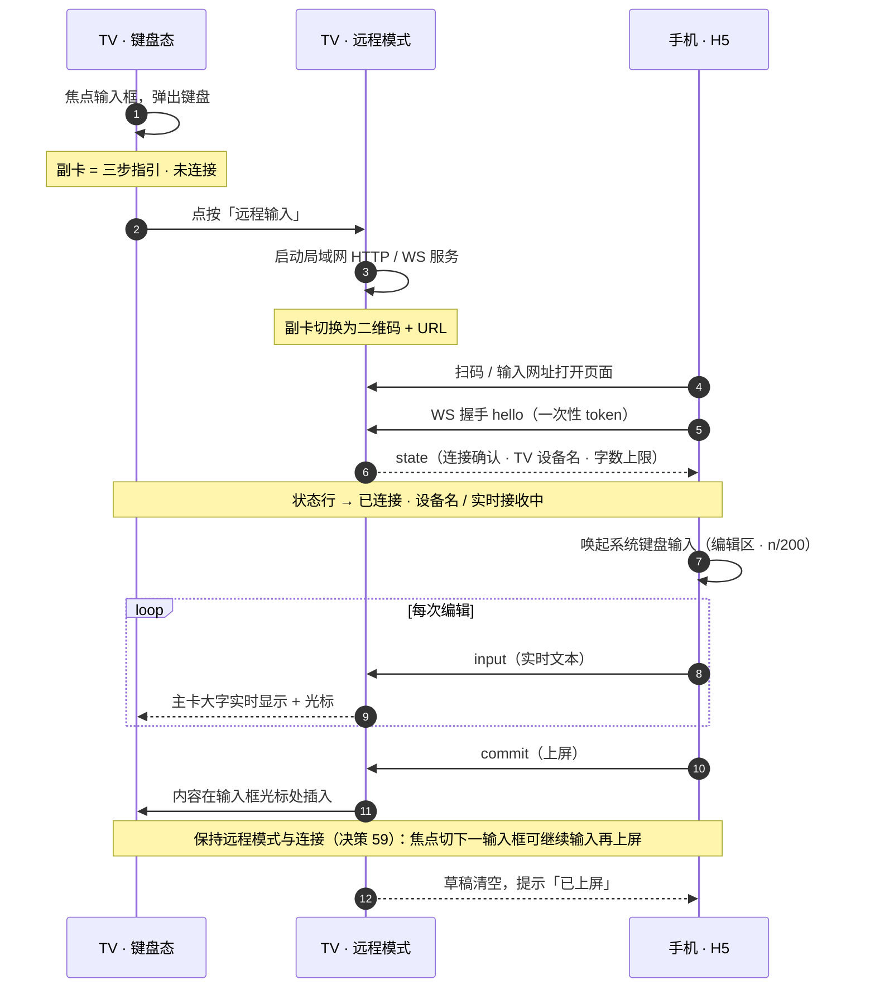
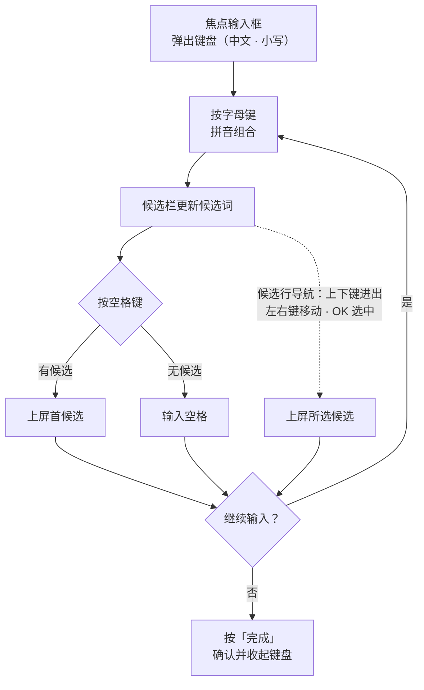

# sofatype 输入法 · 产品需求文档（PRD）

> **⛔ 归档冻结（2026-11-19 户主拍板）**：本文为 v1.2 需求基线快照，**只读、禁止任何更新**；一切变更建 issue（`docs/issues/`，规范见其 README.md）。引用本文条款前，先核对第 12 章决策修订链与相关 issue——条款可能已被后续拍板修订或废止（如 FR-A15「更多⌄」已废止），冲突时以最新拍板 issue 为准（新压旧）。决策 1~78 随本文冻结；新拍板不再使用决策编号，引用一律用 issue 号。

| 项目 | 内容 |
| --- | --- |
| 产品名称 | sofatype 输入法（Android TV 输入法 + 跨屏输入） |
| 文档版本 | v1.2（施工前拍板合入） |
| 文档日期 | 2026-11-04 |
| 文档状态 | 第 1 轮评审结论已合入（决策 R-1~R-6）；决策 13~78 已合入（见第 12 章）；批次 20261112（T63 测试打字）与 20261118（拼音简拼）已并入（4.4 FR-D8 / 4.5 FR-E1，见下方并入说明） |
| 依据资料 | `designs/tv-ime-crossscreen/`、`designs/phone-remote-input/`、`designs/ime-settings/`、`designs/color-schemes/` |
| 目标平台 | Android TV / 智能电视盒子（TV 端），手机浏览器 H5（手机端） |

> **文档维护原则（过时信息处置）**：过时内容不删除——原文用删除线标注（`~~原文~~`），并紧随附上替代它的新规编号（如「→ 被决策 30 取代」）；修订本身仍按编号记入第 12 章决策记录，编号顺延、不重排。现行有效正文不受影响。
>
> **批次并入说明（2026-11-19）**：批次 `docs/PRD_20261112.md`（T63 测试打字）与 `docs/PRD_20261118.md`（拼音简拼）已并入本文，两份批次文件同日删除。需求入 4.4 章 FR-D8 与 4.5 章 FR-E1；批次拍板记录续编为第 12 章决策 70~78。原编号 → 本文编号映射：批次 20261112 FR-D1 → FR-D8、D1/D2 → 决策 70/71；批次 20261118 D1~D7 → 决策 72~78。closed issue 与代码注释中的旧文件名、旧编号按本映射解读。

---

## 1. 产品概述

### 1.1 背景与问题

在 Android TV / 电视盒子上通过遥控器方向键逐个选择字母进行输入，效率极低；中文拼音输入在电视上更是普遍痛点。搜索片名、输入账号密码、填写 Wi-Fi 密码等场景下，用户输入成本高、极易放弃。

### 1.2 产品定位

sofatype 是一款运行在 Android TV 上的第三方输入法（IME），包含两个协同的端：

1. **TV 端输入法**：悬浮卡片式键盘，支持中英文、大小写、全角/半角符号，可用遥控器完成全部输入；
2. **跨屏输入（远程输入）**：TV 端出示二维码，手机扫码后打开网页版输入器，手机上打的字实时显示在电视上，点「上屏」一键写入电视输入框——把手机变成电视的键盘。

辅以一个 TV 端**设置页**（品牌展示、版本信息、检查更新），三端统一使用「星夜青 Aurora Cyan」全深色视觉体系。

### 1.3 产品目标

- 遥控器可独立完成字母、数字、中英文、全/半角符号的完整输入，无操作死角；
- 扫码后 3 秒内手机即可开始为电视打字，编辑内容实时可见、一键上屏；
- 三端视觉与交互一致，暗色环境下舒适、品牌辨识度高。

### 1.4 非目标（本期不做）

- ❌ 语音输入（评审中已明确移除，候选栏不出现语音入口）；
- ❌ 候选栏中显示拼音串（评审决策：只显示候选词）；
- ❌ 云端账号、云词库同步（本期输入全部本地/局域网完成）；
- ❌ 除「星夜青」以外的配色方案（目录名 `P1-Cyan` 表明后续会扩展多配色，本期仅落地一套，见开放问题 O-5）；
- ❌ iOS / Android 原生 App（手机端为纯网页 H5，扫码即用）；
- ❌ 模糊音、双拼、整句输入模式、云候选 / 联想（批次 20261118 拍板不做；混合缩写与声母简拼已按二期落地，见 4.5）。

---

## 2. 用户与场景

### 2.1 目标用户

| 角色 | 说明 | 主要操作设备 |
| --- | --- | --- |
| TV 用户 | 在电视上搜索、登录、填密码的人；即手机用户本人 | 遥控器（十字键 + OK + 返回） |
| 手机用户 | 与 TV 用户为同一人；通过系统相机扫码打开 H5 页 | 手机（系统键盘，含其自装中文输入法） |

### 2.2 核心场景与用户故事

- **S1 追剧搜索**：想搜《客庭的故事》，用遥控器在字母键盘上按出拼音 `keting`，候选栏给出「客厅的 / 客厅 / 客 / 科」，选词上屏。
- **S2 长文本输入**：需要输入复杂的 Wi-Fi 密码/账号，按「远程输入」，电视出示二维码；手机扫码打开「远程输入」页，用手机键盘打字，电视左侧卡片实时显示；点「上屏」写入电视输入框。
- **S3 符号输入**：输入邮箱时用 `@`、`.com` 快捷键；输入密码时切到符号键盘，并用「全/半」键在中文全角与英文半角符号间切换。
- **S4 版本维护**：用户进入系统设置中的 sofatype 输入法设置页，查看当前版本，按 OK 键「检查更新」。

---

## 3. 产品结构

三端共享同一套设计系统「星夜青」（见第 6 章）。

---

## 4. 功能需求

优先级定义：**P0** = 首版必须；**P1** = 首版尽量 / 紧随其后；**P2** = 后续版本。

### 4.1 TV 输入法键盘（FR-A）

键盘为悬浮卡片形态（方案 B · 悬浮卡片），叠加于当前应用内容之上，不整屏跳转。

| 编号 | 需求 | 说明 | 优先级 |
| --- | --- | --- | --- |
| FR-A1 | 键盘唤起与收起 | 在可输入焦点处确认后弹出键盘悬浮卡片；点「下屏」键或系统返回键收起键盘，不丢失已输入内容 | P0 |
| FR-A2 | 键盘布局 | 键盘悬浮层（主卡片约 1272×548 + 右侧副卡 472×548，见 FR-B1）**整体停靠于屏幕底部**，覆盖高约 644px，不遮挡上部内容区（评审结论 R-1）；主卡片上部为候选词栏，下部为 4 行键盘：左侧数字列（1-0、.com、@），中部字母区（a-z），右侧功能键区 | P0 |
| FR-A3 | 大小写切换 | 「上档」键在小写/大写间切换（→ 中文模式下的「上档」行为被决策 43 修订，~~中文态按[大写]切英文态并复位组合与候选~~ → 决策 51 再取代：中文态无[⇧]键、该键位为「分词」键，切英文唯一路径 = [中/英] 键，[⇧] 仅存在于英文模式）；大写态时该键态提示变为「大写已开启，点按切回小写」，字母区全部显示大写（→ 键面形态随决策 51：英文态随大小写输出状态、中文态恒显大写） | P0 |
| FR-A4 | 中/英切换 | 「中/英」键切换中文/英文模式；英文模式按键直出字母，中文模式按键进入拼音组合并产出候选词（切换时组合态处置由决策 43 补定：组合串与候选一律取消、不落定上屏） | P0 |
| FR-A5 | 符号键盘 | 「123_!」键进入符号键盘（初始角态随入口模式：中文态→全角、英文态→半角，决策 52）；符号键盘**没有**大写键与中/英键（评审决策），仅有「全/半」切换键；「返回」键回到字母键盘 | P0 |
| FR-A6 | 全角/半角符号集 | 全角：～ ！ ＃ ￥ ％ …… ＆ ？ （ ） —— ＋ ＝ × ； ： ‘ ’ “ ” ， 。 ／ ＊ 「 」 《 》 ｜ ＼；半角：~ ! # $ ^ % & ? ( ) _ - + = ; : ' " , . / * [ ] { } \| \\ | P0 |
| FR-A7 | 候选词栏 | 仅展示候选词 chips（不显示拼音、不显示语音入口）；候选 chips 无常亮高亮（含首候选；~~首候选高亮（青色描边 chip）~~ → 被决策 30 取代），高亮仅随遥控器焦点态，其后依次排列；候选行支持遥控器焦点进入（上下键进出候选行、左右键在候选间移动、OK 选中上屏，评审补充）；~~英文/数字模式下候选栏隐藏、键盘区上移占满主卡片（评审补充）~~（→ 被决策 42 取代：候选栏空态占位全模式恒定，键区几何不随模式切换）；~~右侧「更多 ⌄」展开更多候选（FR-A15）~~（→ 被决策 53 取代：候选栏单行、行内左右翻页） | P0 |
| FR-A8 | 中文输入引擎 | 拼音组合 → 候选词列表（整句/词组/单字混合排序），选词上屏；组合态空格键：有候选时选首候选，无候选时输入空格（评审结论 R-2）；候选由本地词库产生，无网络依赖 | P0 |
| FR-A9 | 特殊键 | 空格、删除（退格）、`.com` 快捷上屏、`@` 直出；左/右光标键在输入框内移动光标 | P0 |
| FR-A10 | 完成键 | 「完成」键确认当前输入并收起键盘（键位为跨两行的高键，~~青色描边样式~~ → 被决策 44 取代：高亮仅焦点态，常态键帽同款底无描边） | P0 |
| FR-A11 | 遥控器焦点导航 | 十字键在键位间移动焦点，OK 确认；焦点态 = 主色描边 + 微高亮底（见 6.4）；焦点移动路径符合视觉行列关系，不跳变 | P0 |
| FR-A12 | 长按连删 | 删除键长按连续删除，先慢后快 | P1 |
| FR-A13 | 键盘记忆 | 记住上次的中/英、大写锁定状态（按会话；开机后首次打开固定中文默认，决策 51）；~~全/半角状态~~（→ 被决策 52 取代：不记忆，每次进入符号键盘跟随入口模式） | P2 |
| FR-A14 | 按键振动/音效反馈 | 遥控器按键触发轻量触感/音效（系统设置可关） | P2 |
| FR-A15 | 更多候选展开 | ~~点「更多 ⌄」在候选栏下方展开第二行候选（分页展示、左右翻页），再次点按收起；展开行同样支持焦点导航（首轮评审补充）~~（→ 整条被决策 53 取代：候选栏单行、行内左右翻页，「更多」展开废止） | P0 |

### 4.2 跨屏输入 · TV 端（FR-B）

| 编号 | 需求 | 说明 | 优先级 |
| --- | --- | --- | --- |
| FR-B1 | 跨屏输入引导副卡 | 键盘态右侧副卡常驻：标题「跨屏输入」+ 图标；状态行（未连接 = 灰点，已连接 = 绿点 + 设备名）；三步指引文案：① 手机与电视连接同一 Wi-Fi ② 点按「远程输入」出示二维码 ③ 手机扫码，即可远程打字；底部「远程输入」主按钮；按钮下提示「进入后：左侧显示手机输入内容，此卡变为二维码」 | P0 |
| FR-B2 | 进入远程模式 | 点「远程输入」后：主卡片切换为远程模式（FR-B3），副卡切换为二维码配对卡 | P0 |
| FR-B3 | 远程模式主卡 | 状态行：绿点 + 「实时接收中」 + 「来自 · <设备名>（位置）」，右侧「退出远程」按钮；卡片中部以大号文字（40px）实时显示手机输入内容，末尾青色光标；底部提示「在手机上打字，内容将实时显示在这里；手机端点『上屏』后写入电视输入框」 | P0 |
| FR-B4 | 二维码配对卡 | 副卡整卡显示配对二维码（376×376，圆角 38）及下方访问地址一行（如 `http://192.168.1.210:32923/`），地址与二维码内容一致；二维码下方不再显示其他文案（评审决策） | P0 |
| FR-B5 | 实时同步 | 手机端每次编辑在 300ms 内（局域网）反映到 TV 远程模式主卡；~~内容超出显示宽度时滚动展示末尾内容~~（→ TV 端被决策 31 取代：自动折行，超高纵向滚动保持末行与光标） | P0 |
| FR-B6 | 上屏写入 | 收到手机「上屏」指令后，将内容在电视输入框**光标处插入**（不覆盖输入框其余已有文字；若存在选中区间则替换该区间，评审结论 R-3），随后~~自动收起远程模式、回归键盘态~~（→ 被决策 59 取代：**上屏成功后保持远程模式与连接**，手机端可连续编辑并多次上屏，退出仍走 FR-B7）；上屏成功后手机端草稿清空并给出「已上屏」提示（R-4 的「自动收起」条款随决策 59 废止） | P0 |
| FR-B7 | 退出远程 | 「退出远程」按钮或~~系统返回键~~退出远程模式，关闭 HTTP/WS 服务监听，回到键盘态；已接收未上屏内容按丢弃处理并给出提示（~~系统返回键退出~~条款 → 被决策 62 取代：**已连接态 BACK 只收起键盘保会话不退出**，未连接态 BACK 维持本条完整清理退出） | P0 |
| FR-B8 | 断连处理 | 手机关闭页面 / Wi-Fi 断开时：TV 端状态行提示连接已断开~~并回到引导态~~（→ 被决策 35 取代：回等待扫码卡）；手机端显示断连提示，支持刷新重连 | P0 |
| FR-B9 | 连接状态展示 | 副卡状态行三态：未连接（灰点）/ 等待扫码（青点 + 「等待手机扫码」）/ 已连接（绿点 + 设备名，如「已连接 · 小米手机（客厅）」） | P0 |
| FR-B10 | 配对安全 | 二维码 URL 携带一次性配对 token，配对成功后 token 失效；服务仅监听局域网接口 | P0 |
| FR-B11 | 多手机互斥 | 同一时间仅允许 1 台手机保持连接；新手机连接成功时**自动替换旧连接**，旧手机收到「连接已被替换」提示并进入未连接引导态（评审结论 R-5） | P1 |
| FR-B12 | 会话恢复 | 手机端页面意外刷新后，在有效期内可自动恢复会话与未上屏内容 | P2 |

### 4.3 跨屏输入 · 手机端 H5（FR-C）

页面基准尺寸 390×844（适配各类手机屏幕，竖屏单页，无滚动或最小滚动）。

| 编号 | 需求 | 说明 | 优先级 |
| --- | --- | --- | --- |
| FR-C1 | 打开方式 | 手机扫码或输入 TV 显示的 URL 打开；支持系统浏览器及微信等内置浏览器内核 | P0 |
| FR-C2 | 页面结构 | 自上而下：标题「远程输入」；状态行（绿点 + 「已连接 · <TV 设备名>」｜竖分隔线｜电视图标 + 「文字将实时显示在电视上」，紧随标题下方左对齐——评审决策）；编辑卡片；删除 / 清空 双按钮；「上屏」主按钮；页脚「同一 Wi-Fi 下与电视保持连接」 | P0 |
| FR-C3 | 编辑卡片 | 卡片内为已输入内容 + 末尾光标；点击卡片唤起手机系统键盘（用户可使用其自装中文输入法）；右上/右下角显示字数 `n / 200` | P0 |
| FR-C4 | 实时推送 | 每次编辑（输入/删除/清空）立即推送到 TV，TV 端实时显示 | P0 |
| FR-C5 | 删除 / 清空 | 「删除」移除末尾 1 个字符；「清空」清空全部内容（清空前无需二次确认，内容同时从 TV 端移除） | P0 |
| FR-C6 | 上屏 | 「上屏」将当前全部内容写入电视输入框（FR-B6，光标处插入）；内容为空时按钮置灰不可点；成功后草稿清空并提示「已上屏」，可直接继续输入并再次上屏（会话保持，决策 59）（评审补充） | P0 |
| FR-C7 | 字数上限 | 单次远程输入上限 200 字符，达到上限后停止接受输入并轻提示 | P0 |
| FR-C8 | 断连提示 | 与 TV 失去连接时显示断连状态与「重连」入口；重连失败给出引导（检查同一 Wi-Fi、重新扫码） | P0 |
| FR-C9 | 未连接态 | 直接输入 URL 但扫码上下文失效/超时时，展示未连接引导页（提示重新扫码） | P1 |
| FR-C10 | 历史记录 | 保留最近若干条已上屏内容，可一键重新填入 | P2 |

### 4.4 TV 设置页（FR-D）

| 编号 | 需求 | 说明 | 优先级 |
| --- | --- | --- | --- |
| FR-D1 | 入口与面包屑 | 从系统输入法设置/应用入口进入；页面左上角面包屑「sofatype 输入法 ｜ 设置」 | P0 |
| FR-D2 | 品牌区 | 页面居中：品牌 Logo（88×88 圆角方块，青底 + 深青「S」）+ 「sofatype」字标；下方副标题「输入法 · 设置」 | P0 |
| FR-D3 | 版本信息卡 | ~~展示「当前版本 v1.2.3 (63)」（版本号 + build 号）~~（→ 被决策 40 取代）；现展示「当前版本 v1.2.3」格式：仅版本号，不向用户展示 versionCode；卡片下部为「检查更新」按钮与检查结果状态 | P0 |
| FR-D4 | 检查更新 | 点按/OK 触发检查；结果态：① 绿点 + 「已是最新版本」② 发现新版本 → 显示新版本号与更新说明，OK 确认后进入下载（展示进度），完成后直接转交系统安装器完成安装（应用内确认框废止，决策 39），返回设置页按版本号变化判定安装结果（决策 36）③ 检查失败 → 红点 + 失败原因，可重试 | P0 / P1 |
| FR-D5 | 操作提示 | 页面底部提示「按遥控器 OK 键检查更新」，随焦点位置动态切换（P1：焦点落在其他控件时提示对应操作） | P0 / P1 |
| FR-D6 | 配色方案设置 | 多套配色下的主题切换入口；本期色值 Token 化预留但不露出入口（评审结论 R-6，O-5 关闭） | P2 |
| FR-D7 | 其他设置项 | 输入习惯（候选数量、按键反馈等）设置入口 | P2 |
| FR-D8 | 测试打字入口与独立测试打字页 | 设置卡「检查更新」下方新增第三行功能按键「测试打字」，点击/OK 进入独立测试打字页；原设置页顶部调试走查区（测试输入框、「填入示例文本」「全选」）整体迁入该页，设置页不再直接暴露调试区，调试走查与正式设置功能解耦（批次 20261112 需求并入，原批次编号 FR-D1；原型 `designs/20261110` 画板 7/9） | P0 |

FR-D8 细项（批次 20261112 并入，细项编号沿用原批次）：

1. 设置页入口：按钮样式与「检查更新」同款（深底键帽、蓝字、非焦点无常亮——决策 44 高亮收敛口径；焦点态 = `accent-wash` 上界底 + `border-accent` 描边，6.4 口径）。
2. 设置页调试区移除：顶部 `test_input_area`（测试输入框 + 填入示例文本 + 全选）整体移除；移除后页面布局与既有功能（品牌区、版本信息卡、检查更新三态、面包屑、底部提示）回归不变。
3. 测试打字页：承载测试输入框（占位文案「测试输入框：用于键盘与上屏验收」）、「填入示例文本」「全选」按钮；BACK 返回设置页；无 LAUNCHER 入口（不从桌面可达）。
4. 门控：~~沿用现行调试区实现的门控口径（debug 构建可见性等），开工时核对并如实记录于 issue~~（→ 被决策 65 取代：「测试打字」入口与页面内容 release / debug 一致显示）。
5. 无障碍：全部可交互元素无障碍标注齐全，焦点与状态满足可读性要求（第 8 章口径）。

### 4.5 拼音简拼（FR-E）

批次 20261118 需求并入（原批次编号 FR-E1 沿用）。

| 编号 | 需求 | 说明 | 优先级 |
| --- | --- | --- | --- |
| FR-E1 | 拼音简拼（首字母缩写候选） | 中文组合态输入拼音首字母串（如 zg）即命中词库内「首字母串前缀匹配」词条（zg → 这个 / 中国），候选按词库内建频次排序；单字母输入同样出首字母匹配词（现状 21/26 个字母零候选 → 23/26 出候选）；全拼查询行为不回归 | P0 |

FR-E1 细项（批次 20261118 并入）：

1. 匹配口径：词条首字母串 = 各音节首字母拼接（如 [zhong, guo] → zg），与输入做前缀匹配；查询双路并行——全拼前缀路（FR-A8 现行口径不动）+ 简拼前缀路。
2. 合并排序：输入 ≥ 2 字母时全拼命中排前、简拼命中按内建频次排后，词 id 去重；单字母输入取简拼路结果（实测为全拼路超集），按内建频次统一排序。
3. 词库与格式：SPD1 词库格式与文件不变，首字母串运行时派生（加载时从既有音节 id 派生 + 建首字母倒排桶）；实测不达标再评估预置进格式升级。
4. 单字母边界：i / u / v 无候选属拼音体系限制（汉语拼音无以这三字母开头的音节），不判缺陷；其余 23 键单字母即出高频词（实测 z → 在 / 这个 / 中，n → 你 / 那 / 呢）。
5. 空格键：决策 8 R-2 语义不变；首键即有候选后，组合态空格恒为「上屏首候选」，「无候选输入空格」仅在无命中串（含 i / u / v、乱串）时触发（→ 翻页态随决策 78 收窄：翻页后焦点出候选区再按空格，上屏翻页落点页首候选，为预期行为）。
6. 上层不动：ChineseComposer / SofatypeImeService / 候选栏（20 条 + 翻页）复用现状，零改动（决策 75）。
7. 无障碍与性能预算：沿用第 8 章口径；中文候选刷新 ≤ 200ms 以真机实测为准。

二期（已落地）：混合缩写（逐音节「全拼 / 缩写」混排，如 zguo → 中国、srf → 输入法、zhly 声母形态）与声母简拼按二期立项实现（决策 74 / 77，任务 T84，2026-11-19 真机验证归档）。延续不做：模糊音、双拼、整句输入、云候选 / 联想。

立项调研（2026-11-18，决策 72 / 73 依据）：引擎原仅「全拼前缀」单路匹配，z / zh / zho / zg / nh 全部零候选，须打到完整首音节（如 zhong，5 键）才首次出词；词库复算（`pinyin/dictsrc/rawdict_utf16_65105_freq.txt`，65 105 条）：zg 命中 295 词（这个 / 中国前 2）、bj 命中 226 词（北京第 2）、nh 命中 67 词（你好第 1）、单字母 23/26 键出高频词（z 桶 6 169 词条为最坏扫描量级）；排序仅凭词库内建频次即可。

---

## 5. 关键流程

### 5.1 跨屏输入配对流程（主流程）

### 5.2 遥控器输入流程（中文）

> 空格键在中文组合态：有候选时选首候选，无候选时输入空格（评审结论 R-2，O-2 已关闭；「首候选」→ 决策 53 修订为当前页第一候选）。

### 5.3 断连与异常

| 异常 | TV 端表现 | 手机端表现 |
| --- | --- | --- |
| 手机关闭页面/断网 | 状态行回到「未连接」，主卡回到等待扫码 | —（页面已不可达） |
| Wi-Fi 切换（不同网段） | 同上；二维码 IP 失效时自动重建服务并刷新二维码 | 「连接已断开」+ 重连引导 |
| TV 端退出远程 | — | 「电视已退出远程输入」提示，输入禁用 |
| 已连接无活动超时（决策 59，10 分钟） | 视同 TV 端退出远程：自动停服退出并收起键盘 | 「电视已退出远程输入」提示，输入禁用 |
| 键盘进程被杀 | 下次唤起键盘回到未连接初始态 | 页面超时提示重新扫码 |

---

## 6. 设计规范 · 星夜青（Aurora Cyan）

全深色、青主色，三端一致。手机端由浅色改为深色青调（评审决策，见 `designs/color-schemes/`）。色值按下表以设计 Token 集中管理，本期不提供主题切换入口（评审结论 R-6）。

### 6.1 色彩 Token

| Token | 值 | 用途 |
| --- | --- | --- |
| `bg` | `#06080C` | 三端页面背景 |
| `card` | `#12161E` | 卡片/悬浮面板底色（描边 `rgba(255,255,255,.08)`，1~1.5px） |
| `key` | `#1D242F` | 键帽底色 |
| `key-hover` | `#242C39` | 键帽 hover/按压提亮 |
| `accent` | `#38BDF8` | 主色：强调键底色、品牌块、光标、上屏主按钮 |
| `accent-hover` | `#5BC9FA` | 主色 hover |
| `accent-text` | `#7DD3FC` | 主色上的文字/描边文字、焦点描边文字、URL |
| `on-accent` | `#052330` | 主色底上的深青文字（完成/删除强调键、S 标、上屏按钮） |
| `success` | `#34D399` | 连接成功/最新版本状态点 |
| `text-primary` | `#F2F6FB` | 主文字（标题、大字内容、品牌字标） |
| `text-body` | `#E8EEF5` | 键帽字符正文 |
| `text-secondary` | `#C9D4E2` | 功能键文字 |
| `text-muted` | `#7F848D` | 次级文字、说明文案 |
| `border-accent` | `rgba(56,189,248,.5)`（文字态 `.45`） | 主色描边（按钮/焦点/高亮 chip） |
| `accent-wash` | `rgba(56,189,248,.14~.16)` | 主色淡底（~~副卡按钮、候选高亮 chip、完成键~~ → 被决策 44 收敛：仅焦点/高亮态使用，常态不常亮） |
| `divider` | `rgba(255,255,255,.07~.15)` | 分隔线 |

### 6.2 字体

`Noto Sans SC`（兜底 `PingFang SC` / `Microsoft YaHei` / system-ui），权重 400 / 500 / 700 / 900。

### 6.3 控件规格（基准 1080p，4K 屏幕等比 2x）

| 控件 | 规格 |
| --- | --- |
| TV 键帽 | 80×92，圆角 14，字符 30px；功能键文字 22px |
| 候选 chip | 高 52，圆角 12，文字 28px；高亮态 = `accent-wash` 底 + `border-accent` 描边（仅焦点态；首候选无常亮高亮，决策 30） |
| 悬浮卡片 | 圆角 38（平滑苹果式大圆角），底部柔影（黑 55% 模糊 30） |
| 副卡主按钮（远程输入） | 高 60，~~`accent-wash` 底 + `border-accent` 描边~~（→ 被决策 44 取代：常态键帽同款底无描边，焦点态 = `accent-wash` 上界底 + `border-accent` 描边），文字 21px |
| TV 设置·检查更新按钮 | 196×64，圆角 14，~~`accent-wash` 底 + `border-accent` 描边~~（→ 被决策 44 取代：常态键帽同款底无描边，焦点态口径同上），文字 19px |
| 手机次级按钮（删除/清空） | 165×56，圆角 14，`key` 底，文字 15px |
| 手机主按钮（上屏） | 342×56，圆角 16，`accent` 底 + `on-accent` 文字 17px 粗体 |
| 手机编辑卡 | 342×336，圆角 20，`card` 底 + `rgba(56,189,248,.4)` 描边 1.5px |
| 状态点 | 直径 8（TV）/ 8（手机），成功 `success`，未连接 `rgba(232,239,246,.35)` |

### 6.4 状态与焦点

- **焦点态（遥控器）**：主色描边 + 键帽提亮，即「聚焦态 = 主色描边」（设计稿注明）；
- **hover（鼠标/触控模拟）**：键帽 `key-hover`，主色元素 `accent-hover`；
- **连接状态色**：未连接 = 灰点，等待 = 青点（主色），已连接 = 绿点（`success`）。

---

## 7. 通信协议草案（跨屏输入）

传输：HTTP（下发页面）+ WebSocket（双向消息），均监听 TV 局域网地址。

**消息类型（JSON）**

| type | 方向 | 载荷 | 说明 |
| --- | --- | --- | --- |
| `hello` | 手机 → TV | `{ token, deviceName, deviceType, deviceKey }` | 携带二维码中的一次性 token 完成配对；`deviceType` = 手机端判定的设备类型、`deviceKey` = 保号键（均决策 61 增量；旧客户端未携带按匿名处理） |
| `state` | TV → 手机 | `{ connected, tvName, charLimit, clientCode }` | 连接确认与能力下发；`clientCode` = 连接代号，state 为其唯一事实源（决策 61 增量） |
| `input` | 手机 → TV | `{ text }` | 当前编辑区全量/增量文本（实时显示） |
| `cursor` | 手机 → TV | `{ index }` | 光标位置（P1） |
| `clear` | 手机 → TV | `{}` | 清空 |
| `commit` | 手机 → TV | `{ text }` | 上屏写入电视输入框 |
| `disconnect` | 双向 | `{ reason }` | 断连通知 |

安全要求见 FR-B10：token 一次性、仅局域网监听、配对后 token 失效。

---

## 8. 非功能需求

| 类别 | 需求 |
| --- | --- |
| 性能 | 键帽按下视觉反馈 ≤ 100ms；中文候选刷新 ≤ 200ms；手机编辑 → TV 显示端到端 ≤ 300ms（局域网）；扫码到手机页可输入 ≤ 3s |
| 兼容性 | Android TV 6.0+（minSdk 23；~~Android TV 9.0+~~ → 被决策 13 取代，按验收实机口径调整）；APK 须含 armeabi-v7a，首版验收基线设备为小米电视4 `MiTV4-ANSM0`（Android 6.0.1 / armeabi-v7a，见 `devices/`）；TV 分辨率 1080p 基准、兼容 4K 等比缩放；手机端支持 iOS Safari 14+、Android Chrome、微信内置浏览器 |
| 可靠性 | 输入法服务崩溃后可被系统重启且不阻塞宿主应用；远程服务随远程模式启停，退出后不残留监听端口 |
| 安全与隐私 | 按键内容仅在局域网内传输、本地处理，不上传云端；配对 token 一次性；不在本地持久化用户输入内容（含远程输入缓冲，会话结束即清除） |
| 无障碍 | 全部键位/按钮具备 `aria-label`（设计稿已标注：上档切换、下屏收起键盘、删除、光标左移/右移、进入远程输入模式、退出远程模式等）；焦点态满足对比度要求 |
| 电量与资源 | 键盘非激活时不占用 CPU；远程模式空闲（无手机连接）30 分钟自动退出并收起键盘（P1）；已连接无活动（无任何 WS 消息收发）10 分钟自动退出并收起键盘（决策 59） |

---

## 9. 成功指标（首版上线后 30 天）

| 指标 | 目标 |
| --- | --- |
| 跨屏输入渗透率（唤起键盘用户中使用过远程输入的比例） | ≥ 25% |
| 扫码 → 连接成功率 | ≥ 95% |
| 扫码 → 首次成功输入耗时中位数 | ≤ 10s |
| 单次远程输入会话平均上屏字数 | ≥ 15 字（说明确实替代了遥控器打字） |
| 崩溃率（IME 进程） | ≤ 0.1% |

> 埋点仅记录事件计数与耗时，不采集输入内容本身（隐私要求见第 8 章）。

---

## 10. 里程碑

| 阶段 | 范围 | 对应需求 |
| --- | --- | --- |
| M1 · 键盘可用 | 悬浮卡片键盘：字母（大小写）、数字、符号（全/半角）、中/英、候选词、遥控器焦点导航、完成/收起 | FR-A1~A11 |
| M2 · 跨屏输入 | 引导副卡、二维码配对、远程模式主卡、手机 H5 页、实时同步、上屏、断连处理 | FR-B1~B10, FR-C1~C8 |
| M3 · 设置页与打磨 | 设置页、检查更新、长按连删、多手机互斥、无障碍标注补全 | FR-D1~D5, FR-A12, FR-B11 |
| M4 · 增强 | 会话恢复、输入历史、多配色、更多设置项 | FR-B12, FR-C10, FR-D6~D7, FR-A13~A14 |

---

## 11. 风险与开放问题

| 编号 | 类型 | 内容 | 建议 |
| --- | --- | --- | --- |
| O-1 | 开放 | 中文拼音引擎选型：自研整句引擎 vs 集成开源词库（如开源拼音词库方案） | M1 前技术预研，先用词组级引擎兜底 |
| O-4 | 风险 | 微信内置浏览器对 WebSocket/剪贴板等能力的兼容差异 | M2 兼容性测试覆盖微信内核，必要时降级轮询 |
| O-6 | 风险 | 部分 TV 网络 IP 变化导致二维码失效 | 二维码内容在服务启动时生成，IP 变化时自动重建并刷新二维码 |
| O-7 | 开放 | 远程输入 200 字上限是否合理（密码/地址场景足够，长文场景偏紧） | 上线后依据会话字数分布调整 |
| O-8 | 风险 | 跨屏输入走局域网明文 HTTP/WS，密码类内容存在同网段嗅探的理论风险（首轮评审新增） | 首版：一次性 token + 会话结束即清缓冲 + 文案提示敏感密码建议用遥控器输入；TLS 列入后续评估 |

> O-2（空格键行为）、O-3（上屏后行为）、O-5（配色框架）已在第 1 轮评审中拍板关闭，结论见第 12 章；编号不重排以免外部引用错乱。

---

## 12. 已确认的设计决策记录（评审结论）

以下决策已在设计评审中确认，实现时不再反复：

1. **候选栏不显示拼音串**，只显示候选词 chips（`designs/tv-ime-crossscreen/comments.json`）；
2. **不提供语音输入**入口；
3. **符号键盘**没有大写键、没有中/英切换，只有「全/半」切换键；「返回」键位于第二行，空格为跨两行高键，与完成键对称；
4. 远程配对卡**只保留二维码 + 网址一行**，不加其他文案；
5. 手机端状态行（已连接 · 设备名）**置于「远程输入」标题之后**左对齐；
6. 手机端采用**深色青调**（由浅色方案改为与 TV 一致的星夜青）。

以下为第 1 轮 PRD 评审（2026-11-01）新增结论：

7. 键盘悬浮层**停靠屏幕底部**，覆盖高约 644px，不遮挡上部内容（R-1）；
8. 中文组合态空格键：**有候选时选首候选，无候选时输入空格**（R-2，O-2 关闭；→「首候选」随决策 53 修订为当前页第一候选）；
9. 「上屏」为**光标处插入**，不覆盖输入框其余已有文字（R-3）；
10. 上屏后**自动收起远程模式**回键盘态，手机端草稿清空并提示「已上屏」（R-4，O-3 关闭）；
11. 多手机策略：**新连接替换旧连接**，旧手机收到被替换提示（R-5）；
12. 多配色：本期色值 **Token 化预留、不露出切换入口**（R-6，O-5 关闭）。

以下为 2026-11-02 验收准备阶段新增拍板：

13. 兼容基线：首版按 **Android TV 6.0+（minSdk 23）** 执行，验收实机为小米电视4 `MiTV4-ANSM0`（Android 6.0.1 / armeabi-v7a，见 `devices/`）；原「Android TV 9.0+」表述作废，第 8 章已同步修订。

以下为 2026-11-04 施工前拍板（任务拆解同期定稿，施工计划见 `docs/TASKS_20261104.md`）：

14. 工程位置：代码工程创建在仓库根目录，Gradle 工程直接位于仓库根。
15. 拼音词库：~~采用开源词库 CC-CEDICT（CC-BY 4.0）作数据源~~（→ 被决策 28 取代），构建期转换为自有精简格式内置 APK，单字词兜底；来源与许可在仓库根 `NOTICE` 注明，不改设置页视觉。
16. 跨屏服务地址：~~端口随机取系统可用端口，不固定；~~ → 端口分配条款被决策 63 修订（首次随机、持久化、使用期复用）；二维码与访问地址按服务启动时的实际 IP 与端口生成；多网络接口时 IP 取默认路由的 IPv4；IP 变化时重建服务并刷新二维码（O-6）。
17. 检查更新源：GitHub Releases。接口地址可配置、不硬编码；首版开发与验收用 mock 数据，字段格式与 GitHub Releases 一致（tag = 版本名、assets 内 APK = 下载地址、release notes = 更新说明），正式地址后补。
18. 检查更新行为：纯手动触发，不做自动检查。
19. 版本基线：首版 `versionName 0.1.0` / `versionCode 1`，随发布批次递增；~~FR-D3 中「v1.2.3 (63)」仅作展示格式示例~~（→ 被决策 40 取代）。
20. H5 页面下发：打进 APK assets，由 TV 端 HTTP 服务本地下发；H5 用纯原生 HTML/CSS/JS 实现，不引第三方框架与 CDN。
21. 验收辅助输入：设置页内提供测试输入区，仅 debug 构建显示（`BuildConfig.DEBUG` 门控），release 构建设置页与设计稿一致；不单独创建测试宿主应用（→ 测试输入区后迁独立测试打字页 FR-D8（决策 71）；debug 门控随决策 65 放开为 release / debug 一致）。
22. 成功指标埋点：首版仅本地 logcat 打点事件计数与耗时，不含任何输入内容，不做上报通道；验收阶段人工统计。

以下为 2026-11-04 施工中拍板（T1 验收口径）：

23. APK ABI 验收口径：纯 Kotlin/Java 工程（无原生库）的 APK 允许不含 `lib/` 目录，ABI 核查视为通过；未来引入原生库时，`lib/` 仅允许 `armeabi-v7a`（或 `universal` / `noarch`），Gradle 用 `abiFilters` 锁死，并恢复 `unzip` 字面核查。依据：dex 与 ABI 无关；工具链拍板不装 NDK。

以下为 2026-11-04 施工中拍板（T1 评审 · Gradle 工具链口径）：

24. Gradle 版本口径：以 nix package 为准，文档与工程描述不写死 Gradle 版本号；wrapper 三件套由 nix 包内 Gradle 生成，wrapper 发行版版本与 nix 包一致，经已拍板镜像下载并以 `distributionSha256Sum` 钉官方校验和。

以下为 2026-11-05 施工中拍板（派单顺序）：

25. 派单顺序调整：T4（真机安装通道）暂缓，待户主配合接线时再做；先行派发 T5（星夜青 Token + 键盘静态布局，模拟器验收）。依据：T4 为里程碑真机节点，需户主配合接线，且本期无新代码。

以下为 2026-11-05 施工中拍板（状态词口径修订）：

26. 「真机已验证」标注扩展：已完成（已实现）的任务，经真机验证通过后可由户主拍板回溯标注「真机已验证」，取代 2026-11-04 口径中「不回溯修改其他任务状态」的限制。同批回溯标注 T2/T3/T5/T28，真机证据随 T4 真机验证产生；T3 原占位键盘输入项已被 T5 真实键位替换，其真机证据覆盖唤起/收起链路。

以下为 2026-11-06 施工中拍板（T8 开工前拍板）：

27. 符号键盘全角布局：FR-A6 全角符号共 30 个，画板③④符号区仅 28 格（决策 3 空格/完成键跨行占用行 3/4 末两列），无法全部安放，属 PRD 与设计稿真冲突。拍板：保持 4 行结构与决策 3 不动，符号键盘键位微调排入全部 30 个全角符号；符号键盘不含 `.com` 键与 `@` 键（字母键盘已直出两者，输入能力不丢失，S3 场景不受影响）；`designs/` 画板文件不改，符号键盘实现以本条为准。

以下为 2026-11-06 施工中拍板（T9 开工前拍板）：

28. 拼音词库换源：经调研（2026-11-06），决策 15 选定的 CC-CEDICT 选型作废，改用 **AOSP 谷歌拼音词库**（AOSP PinyinIME `jni/data/rawdict_utf16_65105_freq.txt`，65 105 条，每条含词、逐字拼音、内建频次，许可 Apache-2.0）。理由：CC-CEDICT 无词频（排序无依据）且实际许可为 CC BY-SA 4.0（与决策 15 原文「CC-BY 4.0」不符）；AOSP 词库词频内建、逐词拼音齐全、许可最宽松。决策 15 中「构建期转换为自有精简格式内置 APK、单字词兜底、来源与许可在仓库根 NOTICE 注明、不改设置页视觉」的原则继续执行。口径：~~原始词库源文件不提交仓库，构建脚本负责获取并转换~~（→ 被决策 29 取代），转换产物入包；排序频次取词库内建频次；不引入 Rime 等第三方引擎与 GPL 数据。

以下为 2026-11-06 施工中拍板（T9 归档后拍板）：

29. 词库源文件内置仓库：鉴于 AOSP PinyinIME 为弃用多年的冻结仓库（上游不再变化），决策 28 中「原始词库源文件不提交仓库，构建脚本负责获取」条款**作废**，改为源文件直接入库：`pinyin/dictsrc/rawdict_utf16_65105_freq.txt`（3 570 346 字节，入库基线 sha256 `408700f28a56091fa07f3b849a0f134fbfc71e6b2ae9b3f52973a5b076f599ff`）入库并以 sha256 锁定，构建期先校验源文件一致再转换；构建全程**零网络依赖**（移除下载逻辑）。SPD1 转换产物仍不入库（构建产物不入库口径不变）；转换入包、NOTICE 注明、排序取内建频次、单字兜底等口径不变。理由：消除上游漂移风险与构建期网络依赖（含国内网络不稳风险）。

以下为 2026-11-06 施工中拍板（T11 归档后拍板）：

30. 候选栏高亮口径修订：FR-A7「首候选高亮（青色描边 chip）」条款**废止**——候选 chips **无常亮高亮**（含首候选），高亮（`accent-wash` 底 + `border-accent` 描边）仅表达遥控器焦点态：焦点进入候选行时落在焦点 chip 上，焦点移出候选行后无任何 chip 高亮。空格选首候选行为不变（决策 8 R-2 不动）；`designs/` 画板文件不改，实现以本条为准。理由：户主拍板「只有被选中的才能被高亮」；首候选常亮高亮与焦点态同形，易被误读为已选中。落地任务 T31。

以下为 2026-11-07 施工中拍板（T15 归档后拍板）：

31. TV 远程大字区显示口径修订：FR-B5「内容超出显示宽度时滚动展示末尾内容」条款的 **TV 端横向滚动实现废止**——远程模式主卡 40px 大字区改为**自动折行显示**，不做横向滚动；折行后内容超出显示区高度时，纵向滚动保持末尾内容与青色光标可见（FR-B3「末尾青色光标」条款不变）。理由：户主拍板折行显示；`designs/` 画板文件不改，实现以本条为准。落地任务 T33。

以下为 2026-11-07 施工中拍板（T17 开工前拍板）：

32. 跨屏连接状态三态呈现口径：FR-B9「副卡状态行三态」与 FR-B4/决策 4「配对卡整卡只保留二维码 + 网址一行」在副卡 472×548 内几何互斥（配对卡加状态行则二维码容不下 376×376）。拍板：副卡按**整卡面切换**呈现三态——未连接 = 引导卡（灰点状态行 + 三步指引 + 「远程输入」主按钮，FR-B1 原样）；等待扫码 = 配对卡整卡（二维码 + URL 一行，决策 4 不动，**该卡面本身即「等待扫码」态**；户主明确：引导页与二维码+URL 页是两个不同状态）；已连接 = ~~「已连接」独立卡面（绿点 + 设备名，不显示已失效二维码，T14 评审遗留建议一并落实）~~（→ 被决策 35 取代：保留二维码卡 + 网址行原位状态行）；「等待扫码」青点（+「等待手机扫码」）状态行落在**远程模式主卡状态行**的等待态，连接后按 FR-B3 切绿点态。`designs/` 画板文件不改，实现以本条为准。落地任务 T17。

33. FR-B3 主卡框架的 T17/T18 边界：远程模式主卡框架（状态行 + 40px 大字区 + 底部提示 + 「退出远程」按钮）随 **T17** 落地；「退出远程」按钮在 T17 接**既有服务停止链路**（关闭 HTTP/WS 监听、回键盘态、副卡回引导卡），FR-B7 的完整清理语义（通知手机、已收未上屏内容的丢弃提示等）仍归 T18。

34. 配对设备名展示口径：hello.deviceName 从「接收即弃」（T14 口径）改为**会话内存驻留**用于状态行展示——仅驻内存、服务停止即清、不持久化、不入日志（隐私红线不破）；FR-B9 示例「（客厅）」为位置示意，协议无位置字段，按仅有 deviceName 展示。

以下为 2026-11-07 施工中拍板（T17 归档后户主重开副卡已连接态，部分推翻决策 32）：

35. 已连接副卡呈现与配对 token 滚动签发：决策 32 的「已连接独立卡面」**废止**——已连接态保留二维码卡：二维码卡继续整卡显示，下方网址行**原位换成**绿点状态行「已连接 · 设备名」（hello 未携带设备名时只显示「已连接」，决策 34 格式不变）；决策 4「二维码下方不再显示其他文案」只约束等待态配对卡，不变。配对 token 改**滚动签发**：每次配对成功（含被顶替）即签发新 token 并重渲染二维码，每个 token 仍一次性消费（FR-B10 语义逐 token 不变），已连接态展示的码 = 新签发的有效码，供下一台设备扫码。新设备扫码配对成功即**自动顶替**旧连接（FR-B11 提前落地）：TV 向旧连接发 `replaced` 消息后按 4002 关闭，旧手机端显示「连接已被替换」并进入未连接态，副卡状态行与主卡「来自 · 」切新设备名。已配对连接断开（非被顶替）→ 副卡回**等待扫码卡**（新 token 仍有效，二维码可再扫），主卡状态行回青点；FR-B8/T18 的「手机断开回引导态」按本条修订为「回等待扫码卡」，完整断连提示与刷新重连仍归 T18。几何依据：副卡 548px 高 = 上下 padding 40×2 + 二维码 376 + 间距 10 + 一行 22 = 488px，余量 60px，单行状态（20px 文字 + 8px 圆点）直接放得下，决策 32「几何互斥」前提不成立。落地任务 T35。

以下为 2026-11-09 施工中拍板（T27 挂起期拍板，T47 立项）：

36. 检查更新安装链路改走 UI 渠道：基线设备（小米电视4，Android 6.0.1）上，FR-D4 下载完成并~~经应用内安装确认框后~~（→ 被决策 39 取代：下载完成直接转交）**转交系统安装器完成安装**——用户在系统安装器界面确认（安全检测提示、继续/取消均在该界面，机制记录见设备档案坑 15）。决策 17/18 口径中「应用内确认框后 PackageInstaller 会话提交」在 Android 6 基线**废止**，保留为 API 24+ 分支（FileProvider）。安装结果判定：返回设置页比对自身 versionCode——版本升 = 成功，未升 = 用户取消或失败，入「失败可重试」态（UI 渠道无会话回执）。验收用 mock 源必须携带 versionCode 真递增的 APK；同版本复装回执 SUCCESS 不构成「更新成功」（T27 Round 2 假阳性根因）。依据：坑 15——本机会话通道授权判定读 `global install_non_market_apps` 位（UI 开关写 secure 位，不一致即拒 `INSTALL_FAILED_USER_RESTRICTED` 且无界面），授权后提交静默无弹窗、结果不可观测，且真升级从未被验证。落地任务 T47。

37. T39 同进程架构评估结论（2026-11-09 户主拍板：挂账观察）：杀进程 / 空闲期场景默认输入法被回退搜狗 = **本机平台 force-stop 类动作触发 AOSP Android 6 原生重置**——`InputMethodManagerService.onHandleForceStop` 对「当前 IME 的包被 force-stop」清空选中并重选系统默认输入法（源码实证，重选优先系统自带输入法）；已实证触发链：屏保强杀（设备档案坑 9）、TvMgr 清杀（坑 10）、前台同进程 Activity 死亡连带（坑 5 / T12）；真实主场景（第三方宿主 + IME 崩溃）纯进程死亡不触发（T12 变量隔离实证），第 8 章可靠性条款维持满足。处置：**维持现状、挂账观察**——不立项设置页拆独立进程、不立项默认输入法自动写回（写回需 WRITE_SECURE_SETTINGS 且我方进程被回退后不会被拉起，「下次打字时」无法自愈）；弹键盘前核对 `default_input_method` 的走查纪律继续执行。空闲期回退（坑 5 补充 / 遗留④）机制假设 = 坑 9 屏保强杀同链，下次复现抓 logcat `Force stopping` 指纹归并（验证钩子见 issue T39）。

38. 首版收口口径（2026-11-10 T27 首版终验拍板，本条正文补立自 HANDOFF 决策速查既有结论）：v0.1.0 首版收口口径 = 所有 closed 任务均已通过真机验证，或其验收方式本就无需真机（T20/T24 不再追加真机义务）；新发现缺陷 T49/T50 计入首版随 v0.1.0 发布（发版时 CHANGELOG 列已知问题），修复另排。

39. FR-D4 安装确认去重（2026-11-10 户主拍板）：FR-D4 下载完成后的应用内「是否立即安装？」确认框**废止**——下载完成**直接转交系统安装器**（API≤23 UI 渠道经系统安装器包确认 + 小米商店安全审核两道系统级确认，机制见设备档案坑 16；T27 重启批次 B1/B2 实证两道确认系 ROM 固定行为，应用侧不可合并/跳过）；决策 36 口径中「下载完成并经应用内安装确认框后转交」随本条修订，其余口径不变——「失败可重试」态、onResume versionCode 判定链、API 24+ 会话分支均维持。`designs/` 不涉及。依据：两道系统级确认已完整承载用户确认语义，应用内确认框为冗余步骤。落地任务 T51。

40. 设置页版本行去 versionCode（2026-11-11 户主拍板）：FR-D3 版本信息卡展示文本只显示 `v<versionName>`，**不向用户展示 versionCode**——FR-D3 需求行「版本号 + (build 号)」格式随本条废止；versionCode 保留为内部字段，仅用于升级判定链（决策 36）与平台装包语义，不出现在任何用户可见文案。决策 19 读值口径（versionName/versionCode 以构建配置为准）不变，其「v1.2.3 (63)」展示格式示例随本条废止。验证口径：模拟器走查（户主拍板本条免真机）。

以下为 2026-11-11 施工中拍板（T52 开工前拍板）：

41. 符号键盘候选栏占位与键区几何恒定（2026-11-11 户主拍板）：字母 ↔ 符号键盘切换时候选栏**空态几何占位统一保留**——符号键盘与字母键盘一致保留候选栏空态占位，键区顶位置跨键盘切换恒定（以字母键盘现行几何为准），现行「符号键盘候选栏 GONE + 键区上边距清零」行为随本条废止；键盘卡片高度不随键盘类型变化。候选栏**内容**口径不变：符号键盘无候选内容，候选装载仍仅由中文组合态触发（占位几何恒在，内容按既有条件出入）。`designs/20261110` 符号板（SymbolsFull / SymbolsHalf）随本口径回写（补候选栏空态占位）；`designs/tv-ime-crossscreen` 原画板不改。依据：2026-11-10 设计反向同步走查实证键区约 70px 垂直跳动（候选栏 52px + 间距 18px），户主拍板缺陷成立。落地任务 T52。

以下为 2026-11-11 施工中拍板（T53 立项拍板）：

42. 候选栏空态占位全模式恒定（2026-11-11 户主拍板）：候选栏空态几何占位**无条件保留**——中/英模式 × 字母/符号键盘全组合键区顶位置恒定，中/英切换不再整栏隐藏、键区不上移；FR-A7「英文/数字模式下候选栏隐藏、键盘区上移占满主卡片」条款**废止**（第 8 章已同步标注）。候选**内容**口径不变：候选装载仅由中文组合态触发（字母键盘 × 组合态有候选），英文/符号键盘候选栏恒为空态占位。决策 41 中「占位随语言模式切换（中文占位 / 英文隐藏）」的半边口径随本条修订为全模式恒定，其余口径（符号键盘占位、键区顶跨键盘恒定、卡片高度不随键盘类型、designs/20261110 回写）不变。代价拍板知悉：英文模式候选栏永久为空态占位（约 70px 空带，无候选内容）。依据：户主真机使用反馈「切换到英文界面，候选框没预留」，拍板键区几何应全模式恒定。远程模式候选栏显隐（T17，renderRemoteUi 驱动）不在本条范围。落地任务 T53。

43. 模式切换键组合态复位口径（2026-11-11 户主拍板）：字母键盘两条模式切换键必须同时复位组合与候选，组合串与候选一律取消、不落定上屏。①中文输入态（含拼音组合 / 候选词）按「上档」键：切换为英文输入状态，组合串与候选词取消；~~大小写状态随该键语义翻转（默认小写态落大写英文）~~（→ 被决策 49 取代：固定落英文小写）；英文态「上档」键维持 FR-A3 纯大小写切换不变（→ 本条①中文态[上档]路径随决策 51 废止：中文态无[⇧]键位、改「分词」键，中文→英文切换唯一路径 = [中/英] 键）。②英文态按「中/英」键：切换为中文输入状态，落零候选词干净态。FR-A3 条款中「上档键」在中文模式下的行为随本条修订（英文模式行为不变），FR-A4 中英切换语义不变（本条补定切换时组合串处置：取消、不落定上屏）。依据：2026-11-11 户主真机使用反馈「中文态按[大写]后候选词残留并被输入进输入框；英文大写态按[中/英]后未落中文零候选态」。落地任务 T55。

以下为 2026-11-12 施工中拍板（T57 开工拍板）：

44. 高亮收敛全页面推广（2026-11-12 户主拍板）：决策 30「只有被选中的才能被高亮」口径由候选栏推广至全部页面——任何页面仅当前选中（遥控器焦点）的按键 / 候选词 / 按钮呈现高亮（焦点态 = `accent-wash` 上界底 + `border-accent` 描边，PRD 6.4 口径不变），非焦点元素不得常亮高亮。收敛范围（非焦点常亮元素盘点清单，2026-11-12 户主确认）：①完成键（字母 / 符号键盘）——`accent-wash` 底 + 青色描边常态废止，FR-A10「青色描边样式」条款随本条修订为焦点态口径；②副卡「远程输入」主按钮；③设置页「检查更新」按钮与 debug 测试区「填入样例」「全选」按钮——②③常态改键帽同款底（key）无描边；④上档键大写（UPPER）激活态不再复用完成键常亮形态（wash 底 + 描边废止，画板② 激活底口径随之废止），激活提示仅保留图标 / 文字色切换与无障碍标注。保留项（拍板不动）：引导卡三步序号圆（纯展示件）、debug 测试输入框常态编辑卡描边（PRD 6.3 编辑卡口径）、状态点 / 品牌块等语义与品牌元素、候选栏决策 30 既有口径；手机 H5 远程输入页不纳入（触屏页无遥控焦点概念，设计稿定稿不改）。`designs/` 画板文件不改，实现以本条为准。依据：2026-11-11 户主真机使用反馈「[完成]、[远程输入] 及设置页按钮等未被选中仍高亮」。落地任务 T57。

以下为 2026-11-12 施工中拍板（T64 开工拍板）：

45. 符号键盘 7×5 同位语义矩阵重构（2026-11-12 户主拍板，**推翻决策 27**）：符号键盘重构为 7×5 真实矩阵（5 行 × 7 符号列，共 35 键位），全角/半角两页**同位置同语义**——同一格位在两页只差全角/半角输出（半角直引号无左右形态，R2C1-C4 同位输出 " " ' '）。键位以原型定稿 `designs/20261110` 画板 3/4（默认态 R1-R4 + 下箭头）与画板 10/11（下移态 R2-R5 + 上箭头）为唯一依据：全角 R1 ，。、？！；：｜R2 “”‘’（）《｜R3 》【】…—～·｜R4 ／＿｜＠＃％＆｜R5 ＋＝＊＄＾｀￥；半角 R1 , . \ ? ! ; :｜R2 " " ' ' ( ) <｜R3 > [ ] ... -- ~ ·｜R4 / _ | @ # % &｜R5 + = * $ ^ ` ¥（半角 R5C7 为半角 ¥ U+00A5）。数字列与字母键盘对齐：1-9 + 第四行 `.com` `0` `@`，**决策 27「符号键盘不含 `.com` 键与 `@` 键」条款随本条废止**（决策 27 其余口径被本矩阵整体取代）。行步进窗口：界面恒显示 4 行（非自由滚动），光标在显示第 4 行按[下]且下方还有真实行时窗口下移一行、符号内容切换但光标屏上位置不动（落显示第 4 行 = 原下一行同列键）；显示第 1 行按[上]同理回移；边界外不越界。数字列与功能键列固定不随窗口滚动，仅符号区 7 列切换；窗口偏移跨全/半切换保留（两页同位）。边界暗示：显示窗下方还有真实行时显示第 4 行底部居中小下箭头、上方还有真实行时显示第 1 行上方小上箭头（灰 `rgba(232,239,246,.5)`、装饰性、无障碍不标注、不进焦点链）。键区顶恒定与候选栏空态占位（决策 41/42）口径不变。依据：户主 2026-11-12 拍板的符号键盘重设计（高频中文标点前置、成对符号聚合、网址/邮箱/代码常用符号入 R4、低频符号入 R5；全角/半角同位置同语义降低切换记忆负担；数字列统一消除两套布局差异）。落地任务 T64。

以下为 2026-11-13 施工中拍板（T65 立项拍板）：

46. 键盘键面样式与默认态五项调整（2026-11-13 户主拍板）：①[完成]键（字母 / 符号键盘）**常态不高亮**、样式与普通键一致——决策 44-① 常态键帽同款口径在键盘键面的落地确认，画板此前「完成键常驻强调态」标注随本条废止（无行为变更，设计稿回写）。②[中/英]、[全/半]状态键**显示当前态**（此前键面为无状态纯标签）——指示方案三选一（A 键内分段亮灭 / B 单字 + 指示条 / C 斜杠排版当前态下划线）经户主拍板选 **C**：保留「中/英」「全/半」斜杠排版，当前态字符亮蓝（`#7DD3FC`）加粗 + 下划线、非当前态压暗（半透明白 50%），指示随切换实时随动；焦点态叠加口径不变（决策 44：高亮仅焦点态）。~~③**默认态**：字母键盘默认**英文输入**、符号键盘默认**半角**。~~（→ 被决策 51 / 52 取代：开机后首次打开默认中文；符号键盘角态随入口模式）④上档 ⇧ 图标 24→32px、笔画同步加粗（视觉尺寸调整）。⑤下屏 / 收起键图标更换为「键盘面 + 键盘下方加粗下箭头」（强化向下收起意象）。原型依据：`designs/20261110` 画板 1/2/3/4/10/11 已按本条同步修订（本批画板为修订后的唯一原型依据）。落地任务 T65。

以下为 2026-11-13 施工中拍板（T65 立项后补充拍板）：

47. 触发态统一与非选中键样式一致（2026-11-13 户主拍板，细化决策 44 / 46-②）：①**触发态统一原则**：[中/英]、[全/半]、[上档]三键被触发（激活）时的键面样式统一为「当前项加亮 + 下划线」——[中/英] / [全/半] 当前态字符亮青（`#7DD3FC`）加粗 + 3px 下划线（决策 46-② 方案 C 口径不变）；[上档] 大写激活态由「深蓝实底 + 青描边」（画板② 现状）改为同构形态：⇧ 图标亮青 + 图标下方 3px 短下划线条，激活底色与描边废止（决策 44-④「激活提示仅图标 / 文字色切换」随本条细化为图标亮青 + 下划线）。②**非选中键样式一致原则**（决策 44 的补强条款）：所有非触发、非选中（无焦点）的按键不得呈现任何高亮，且**字体样式与普通按键一致**——文字颜色用普通键文字色（`#E8EEF5`）、字重 400，按键青色文字（`#7DD3FC`）与 600 字重废止；适用范围：键盘副卡[远程输入]、设置页[检查更新][测试打字]、测试打字页[填入示例文本][全选]、远程模式[退出远程]等全部功能按键（背景键帽同款 + 中性边框口径维持决策 44）。保留项不变：焦点 / 选中态高亮（决策 44）、引导卡三步序号圆、品牌 Logo 与语义色（状态点 / 品牌块）、配对卡网址行（信息行非按键）、debug 测试输入框常态编辑卡描边（PRD 6.3）、手机 H5 页（决策 44 排除口径）。`designs/20261110` 画板（键盘 6 板 + 设置页 + 测试打字页 + 远程 2 板）已按本条同步修订。落地任务 T65（键面部分随 T65 实现；设置页 / 测试页 / 远程卡对应实现核对一并归 T65 验收）。

以下为 2026-11-13 施工中拍板（T65 立项后补充拍板 · 默认大写与键面形态）：

48. 字母键盘默认大写与键面恒显大写（2026-11-13 户主拍板，细化决策 46-③；~~默认英文 + 大写~~ → 被决策 51 取代：默认中文、英文默认小写）：~~①字母键盘默认态 = **英文输入 + 大写**~~（→ 被决策 51 取代：开机后首次打开默认中文，英文态默认小写）——键盘打开即 ⇧ 处于触发态（触发态样式按决策 47-①：图标亮青 + 图标下方下划线），本字母输出为大写；⇧ 的翻转行为不变（英文态切换大小写输出、中文态按下切英文，决策 43）。②**字母键面恒显大写**（→ 随决策 51 修订：恒显大写仅中文模式，英文态键面随大小写输出状态）——中 / 英两种输入模式下字母键面一律显示大写字母形态，~~键面不随大小写输出状态或输入模式变化~~；大小写输出状态仅由 ⇧ 触发态表达（触发 = 输出大写，未触发 = 输出小写）。原型依据：`designs/20261110` 画板 1 重定义为「键盘 · 默认态（英文 · 大写 · 空输入态）」（⇧ 触发态 + 焦点在 A 键）、画板 2 重定义为「键盘 · 中文输入态（键面恒大写 · 候选示意）」（候选 chips 恒定占位内填充，决策 1 不显示拼音串、决策 30 chips 无常亮高亮；⇧ 未触发）。落地任务 T65。

以下为 2026-11-13 施工中拍板（T65 立项后补充拍板 · 中文态按上档落点）：

49. 中文态按[上档]落英文小写（2026-11-13 户主拍板，修订决策 43-①；→ 本条随决策 51 废止：中文态无[⇧]键位、该键位改「分词」键，中文→英文切换唯一路径 = [中/英] 键，复位语义保留于模式切换、决策 43-② 不变）：~~中文输入态（含拼音组合 / 候选词）按[上档]键 → 组合串与候选**取消、不落定上屏**（决策 43 取消语义不变），切换为**英文输入小写状态**——⇧ 未触发、后续输出小写；键面仍恒显大写形态（决策 48-②），⇧ 触发态为唯一大小写指示。~~决策 43-①「大小写状态随该键语义翻转（默认小写态落大写英文）」随本条废止（固定落英文小写，不翻转）；英文态按[上档]维持 FR-A3 纯大小写切换不变。落地任务 T65（实现随 T65；T55 已归档的取消语义不变；本条 [⇧] 中文态路径随决策 51 废止、实现随 T66 返工）。

以下为 2026-11-13 施工中拍板（T65 立项后补充拍板 · 默认焦点与焦点底色）：

50. 远程模式默认焦点与焦点底色区分（2026-11-13 户主拍板，细化决策 44 焦点态）：①进入远程模式（等待扫码 / 已连接两态）时，[退出远程] 键**默认持有焦点**（呈现选中态，OK 直接触发退出路径）。②**焦点态底色与普通键帽明确区分**——焦点键背景统一用 accent-wash 淡青底（~~`rgba(56,189,248,.16)`~~ → 数值随决策 54 加深为 `rgba(56,189,248,.28)`）+ border-accent 描边（PRD 6.4 口径），画板原焦点底 `#242C39`（灰调，与普通键帽 `#1D242F` 区分度不足）废止；焦点键文字维持普通键色 `#E8EEF5`（青字废止，`#7DD3FC` 焦点文字同废止）。适用全部焦点键（键盘默认焦点键、远程[退出远程]等）。`designs/20261110` 画板已同步修订（键盘焦点键 A / 1 / ＋ 与远程两板[退出远程]）。落地任务 T65。

以下为 2026-11-13 拍板（T66 立项 · 默认态与候选交互修订）：

51. 字母键盘默认态与模式键位修订（2026-11-13 户主拍板，修订决策 46-③ / 48 / 49）：①**默认态**：字母键盘开机后首次打开 = **中文输入**——会话内记住上次中/英（FR-A13 记忆口径保留），开机后首次打开固定中文、不随上次模式；[中/英] 键当前态指示不变（决策 46-②）。②**中文态键位**：中文模式**无[⇧]键**，该键位为**「分词」键**（键面「分词」、功能键样式）——组合态内插入拼音切分符（如 xi'an），选词后切分符不落正文；无组合态按键忽略；组合串无候选原样上屏不带切分符。中文 → 英文切换唯一路径 = [中/英] 键（决策 43-② 复位口径不变）；决策 49 的中文态[上档]路径随本条废止。③**英文态**：默认**小写**输出；键面**随大小写输出状态**——小写态键面小写、大写态键面大写（决策 48-②「键面恒显大写」修订为仅中文模式恒显大写）；[⇧] 切换，触发态样式不变（决策 47-①）；英文撇号（如 don't）经符号键盘半角 R2C3/C4 输入（同键位是[⇧]，户主确认接受）。中英切换瞬间键面形态翻转拍板接受。原型依据：`designs/20261110` 画板 1 重定义为「默认态（中文 · 空输入态）」、画板 2「中文组合态」、新增画板 12（英文 · 小写）/ 13（英文 · 大写），2026-11-13 回写。落地任务 T66。

52. 符号键盘入口角态随输入模式（2026-11-13 户主拍板，修订决策 46-③）：[123_!] 进入符号键盘的初始角态**跟随入口模式**——中文态进入落**全角**（画板 3/10）、英文态进入落**半角**（画板 4/11）。进入后[全/半]手动切换照常（决策 45 键位矩阵不变），手动切换仅本次符号键盘停留期生效；返回字母键盘后再进入**重新跟随入口模式**（不记忆手动选择）。原型依据：`designs/20261110` 画板 3/4 标题与注释（2026-11-13 回写）。落地任务 T66。

53. 候选栏单行与行内翻页（2026-11-13 户主拍板，废止 FR-A15、修订决策 8）：候选栏**仅单行**，FR-A15「更多 ⌄」展开第二行候选机制**废止**（FR-A7「右侧更多 ⌄」条款随废）。按候选词 = **上屏不变**。翻页交互：左右翻页箭头**固定于候选框两侧**——`<` `>` 字符样式（约 30px 加粗），可翻页方向提亮 `#E8EEF5`、不可翻页方向变暗 `rgba(232,239,246,.35)`；装饰暗示、`aria-hidden` 无障碍不标注、**不进焦点链**（同决策 45 边界箭头口径）。遥控器翻页：焦点在行尾候选按[右]翻下一页、焦点在行首候选按[左]回上一页。翻页后**~~焦点落页首第一个候选~~**（→ 落点随决策 55 修订：下翻落当页首、上翻落当页尾）；**空格 = 选当前页第一个候选**（决策 8「有候选时选首候选」的「首候选」随本条修订为当前页第一候选；无候选输入空格不变）。单行页容量按候选栏宽度自适应容纳（画板示意 5 chips），长句多页逐页翻拍板接受。原型依据：`designs/20261110` 画板 2（候选单行 + 固定箭头，首页 `<` 暗、`>` 亮）。落地任务 T66（实现：`CandidateMoreRow.paginate`「更多」分页改造为行内箭头模型；HANDOFF 坑 10 分页区间相对坐标系注意）。

54. 焦点键底色加深（2026-11-13 户主拍板，修订决策 50-② 数值）：焦点键背景 accent-wash 淡青底由 `rgba(56,189,248,.16)` 加深为 **`rgba(56,189,248,.28)`**（编辑器 hover 随动 `.34`）；border-accent 描边、焦点文字 `#E8EEF5` 与适用范围（决策 50）不变。依据：户主看板反馈 `.16` 与键帽区分度不足。`designs/20261110` 全部焦点位已同步（画板 1/3/4/5/6/10/11/12/13）。落地任务 T66（T65 已按 `.16` 实现部分返工）。

以下为 2026-11-14 拍板（T67 立项 · 交互修订三合一，户主指示暂不实现）：

55. 候选翻页焦点落点分向（2026-11-14 户主拍板，修订决策 53「翻页后一律落页首」条款）：候选行内翻页后焦点落点**随翻页方向**——焦点在行尾候选按[右]**翻下一页**，焦点落**当页（新页）首候选**（决策 53 既有口径保留）；焦点在行首候选按[左]**回上一页**，焦点落**当页（回翻页）尾候选**（同原 T11 展开行「回翻落页末」口径，该口径曾随决策 53 废止、本条恢复）。其余条款不变：翻页箭头样式与不进焦点链、空格 = 选当前页第一候选（决策 53）。落地任务 T67（已收口归档，2026-11-14）。

56. 键盘最右列按[右]直达「远程输入」（2026-11-14 户主拍板，修订 FR-A11「表缘不动」在键盘右缘的口径）：字母 / 符号两键盘**最右列（第 12 列）全部按键**（[下屏] / [删除] / [完成]，两键盘该列键位同构）按[右]，焦点跳转副卡引导卡「远程输入」主按钮——现行仅行 3/4 纵向带按键可达（实际只有跨行 [完成] 键），行 1/2 最右键按[右]表缘不动，随本条废止。副卡为配对卡 / 已连接卡（无该按钮）或远程模式主卡时维持表缘不动；从按钮按[左]回进入前键位（T17 既有口径）不变。落地任务 T67（已收口归档，2026-11-14）。

57. 设置页返回键二次退出（2026-11-14 户主拍板，修订设置页 BACK 单击直退行为）：设置页（键盘隐藏态）按系统返回键**第一击不退出**，只在屏幕下方弹文字提示**「再按一次返回退出sofatype设置页」**——提示形式 = **系统 Toast**（底部居中短暂浮现，不新增页面元素、不改设计稿定稿）；**2 秒内**再按返回键直接退出设置页，**超窗重新计**（首击只提示不退出）。键盘显示态 BACK 先收起键盘（FR-A1）与测试打字页 BACK 返回设置页（T63）语义不变。依据：户主真机使用反馈单击 BACK 即退出易误触。落地任务 T67（已收口归档，2026-11-14）。

58. 键盘单板直出改版（2026-11-14 户主拍板，修订 FR-A2「主卡片约 1272×548 + 右侧副卡 472×548、覆盖高约 644px」与 FR-B1/FR-B4 副卡几何口径）：IME 键盘呈现废止左右双悬浮卡片形态，改**单板从屏幕底部直出**——单板铺满屏幕底部全宽（1920），板高随内容排版：4 行键盘板高 392（原窗口 596），**远程模式板高与键盘一致（392）**；键帽 80×92（高>宽）改 **96×64（宽>高）**，行距 12→10、圆角 14→12，整体扁平化，完成键 / 空格键维持跨三四行；跨屏输入副卡（FR-B1）并入单板右分区（366 宽，无分隔线，非独立卡片）；远程模式主卡与二维码副卡（FR-B2/B4）同改单板左右分区（无分隔线），二维码随板高自适应 376→316（圆角 38→32），配对卡网址行 15px→12px（内容仍与二维码一致）；候选栏与键区排版逐键保留，焦点 / 触发态口径沿用决策 44/46/47。原型画板 `designs/20261114`（13 板，2026-11-14 出稿）为视觉基准；`designs/20261110` 定稿画板暂不改，实现以本条为准。落地任务 T68（已收口归档，2026-11-14）。

59. 远程输入上屏保活（2026-11-14 户主拍板，修订 FR-B6「上屏成功自动收起远程模式」与评审结论 R-4）：手机点「上屏」写入成功后**不再自动停服收起远程模式**——WS 连接与远程模式保持，手机端草稿清空并提示「已上屏」后可直接继续编辑、再次上屏；多输入框表单只扫一次码，上屏内容始终落电视**当前焦点**输入框。TV 端上屏成功即清空大字区与远程缓冲（立即回等待输入态），状态行保持「已连接 · 设备名」。退出通道不变：「退出远程」按钮 / BACK 走 FR-B7 完整清理链路；既有「无手机连接」30 分钟空闲自退（T25 口径）不变；新增**已连接无活动超时**——连接保持期间无任何 WS 消息收发满 **10 分钟**自动停服退出并收起键盘（走 FR-B7 通知链路通知手机），防明文 LAN 会话窗口无限延长（O-8 风险边界）。安全与隐私边界不破：token 仍一次性（FR-B10）、断连 / 退出即清缓冲（第 8 章）、输入内容不持久化不上云；协议无新增消息类型。依据：户主反馈多输入框场景每上屏一次即拆会话、须重新扫码，效率过低。落地任务 T70（已收口归档，2026-11-14）。

60. 设置页调试日志功能（2026-11-14 户主拍板细化对齐；原型画板 `designs/20261114` 画板 7 修订 / 14 / 15 当日出稿、check 通过）：设置页「测试打字」下方新增第四行「日志」入口（正式功能，release 与 debug 行为一致；行右侧状态点 + 「调试日志已关闭」默认态），OK 进入日志子页，子页三项：①「开启调试日志」开关，**默认关闭**——只控制文件写入，logcat 通道不动（历轮走查取证链不变）；关闭时②③置灰不可调，已写文件保留（清空只走查看页按钮，卸载即清）。②「日志大小限制」四档 1/2/5/10 MB、默认 2 MB，选中档 = 亮青加粗 + 3px 下划线（决策 47 触发态口径）；超限**轮转覆盖保留最新**（环形语义），轮转触发自身落一条日志。③「查看日志」只读浏览页：进入定位最新（底部）、上下键滚动、[刷新] 手动刷新、[清空日志] 需确认，无导出（取证走 adb pull）。落盘 = 应用私有目录单文件（`filesDir/logs/`），专用线程异步写入 + 行缓冲（不落主线程），写失败降级不崩。日志组件采用 **Timber**（户主明确指令，构成「纯 Kotlin 无第三方 SDK」约束的指令例外，随 ZXing 先例入册）：双树 = logcat 树（行为同现状）+ 文件树（开关控制）；现有全部日志点（ImeKeyTrace 31 点 / 远程服务 26 点 / 更新与设置页 15 点）机械迁移、文案不变；`ImeKeyTrace` 门控从「仅 debug 构建」放宽为「debug 构建 或 开关开启」（release 开关即记键控轨迹；键码/焦点 id 无隐私）。新增日志点：开关切换、轮转触发、清空动作、写失败降级、IME onCreate/onDestroy、未捕获异常栈（写文件后交回系统默认处理，崩溃行为不变）。隐私红线全部继承：文件日志零输入内容/组合串/候选词/远程文本/deviceName（决策 34）；token 仅出现在服务启动/重建行配对地址（T27 拍板不打码）；单测守卫扩到「文件日志无输入内容」。开关/档位持久化用 SharedPreferences（仅配置项）——T27「全源集无持久化 API」审计口径随之失效，issue 如实记录（不涉输入内容，红线不破）。依据：真机问题排查需现场日志，logcat 依赖 adb、不面向用户。落地任务 T71（closed，2026-11-15 真机验证归档）。

以下为 2026-11-14 拍板（T72 立项 · 远程输入连接代号，2026-11-15 户主批准开工入册）：

61. 远程输入连接代号（2026-11-14 户主逐项拍板；原型画板 `designs/20261114` 画板 6 / 8 + 同画布 connect-id 便签，当日改毕、check 通过）：配对成功后 TV 与 H5 两端同显同一**连接代号胶囊 = [官方标 icon][设备类型]设备[两位序号]**（示例「微信设备 01」），替代现状两端硬编码「browser」展示口径（现状 H5 自报 `deviceName:'browser'`、TV 照显）。①**类型判定**在手机端完成、随 `hello` 上报 `deviceType`：微信→苹果→安卓→浏览器命中即停，**TV 不解析 UA**。②**序号签发保号**：TV 端 LRU 内存表 `deviceKey→(类型, 序号, lastSeen)`——`deviceKey` = H5 首访生成随机 UUID 存 localStorage、随每次 `hello` 上报；命中沿用原序号（刷新 / 断线重连 / 被顶替后再连，窗口内代号不变）、未命中取全表最大序号 +1（表空回 01）；条目 TTL **15 分钟**自最近一次 WS 活动滚动续期（已连接期间持续续期，**连接中代号永不变**，代号刷新只发生在重连时刻）；容量上限 **8 台**、满淘汰最久未见；`hello` 未携带 `deviceKey`（旧缓存页 / 非浏览器客户端）按**匿名新设备**签发、仅当次连接内固定。与决策 59「已连接无活动 10 分钟断连」衔接：断开后窗口自最后活动起算 15 分钟，期内重连保号。③**协议增量**：`hello{deviceType, deviceKey}`、`state{clientCode}`（第 7 章已同步）——**state 为代号唯一事实源**，新代号随 state 下发、客户端收到即覆盖显示，无新增消息类型。④**呈现**：中性浅灰胶囊，四类型 icon 全套官方标（商标风险户主自担）——安卓=绿 `#3DDC84`（官方机器人头）/ 苹果=银灰 `#94A3B8`（官方苹果标）/ 微信=微信绿 `#07C160`（官方双气泡 + 白眼；几何 = 左大气泡左上在后、右小气泡右下在前，户主纠形）/ 浏览器=紫 `#A78BFA`（地球——品类无官方标，保留通用图形）；官方标落地用官方品牌素材、**不手描**；icon 外文字纯白 `#F2F6FB`；icon 尺寸 TV 22 / H5 18（户主两次加大）；画板示例 = 微信设备 01。位置：TV 主卡「来自 ·」与副卡「已连接」状态行（画板 6）、手机端「远程输入」标题后（画板 8）；FR-C2 状态行「已连接 · TV名」保持不变。⑤**隐私红线**沿决策 34 / 60 延伸：`deviceKey` 与序号**仅 TV 内存驻留**，不持久化、不入日志——决策 60 文件日志单测守卫扩展「零 deviceKey / 序号」；H5 localStorage 只存客户端自生成随机 UUID（无身份关联、不上云）。落地任务 T72（closed，2026-11-15 真机验证归档）。2026-11-15 补充拍板：macOS 桌面浏览器 UA（含 Macintosh）判苹果设备、维持现状（真机批次实测观察，户主定性）。

62. 远程模式 BACK 已连接保活（2026-11-15 户主拍板，修订 FR-B7「系统返回键退出远程模式」条款与决策 59「退出通道不变」中 BACK 部分）：远程服务运行中按系统返回键按连接态分流——**已连接态（存在已配对会话）BACK = 只收起键盘窗口（FR-A1 语义），不退出远程**：HTTP/WS 服务监听、已配对会话、远程缓冲与连接代号全部保持，手机端无感知（无 disconnect 通知、页面不关）；用户切到同页其他输入框后唤起键盘，经既有重入路径自动回到远程模式（状态行「已连接 · 代号」），多输入框表单全程零扫码。**未连接态（等待扫码，无已配对会话）BACK = 维持现行 FR-B7 完整清理退出**（通知手机 + 关 HTTP/WS 监听 + 清 token / 远程缓冲 / 设备名，回键盘态），不在无人使用时残留监听端口。保活收起不清远程缓冲（未上屏内容保持，手机端可继续编辑并上屏）；上屏落「当前焦点输入连接」（决策 59 既有语义，无焦点输入框时走既有失败可重试链路）。显式退出通道收窄为「退出远程」按钮（默认持有焦点，决策 50 口径，OK 一击即退）；退出时的完整清理语义（通知手机、丢弃未上屏内容并提示）仍走 FR-B7 既有链路。保活窗口兜底不变：已连接无活动 10 分钟自退（决策 59）在键盘收起期间照常计时到期，与无手机连接 30 分钟空闲自退（T25）并存；到期即完整退出，不因键盘已收起而顺延。安全与隐私边界不破：服务仍仅监听局域网接口（FR-B10）、BACK 收起动作本身不落任何输入内容日志、协议无新增消息类型；保活暴露面由既有 10 分钟无活动超时封闭，不新增风险面。5.3 表「TV 端退出远程」行语义不变——保活收起不构成退出远程事件，不触发手机端断连提示。依据：户主反馈多输入框切换须 BACK 收起键盘，现行 BACK 即拆会话（停服清 token + 服务重启随机换端口、deviceKey 判新设备）导致频繁扫码。落地任务 T74（open，2026-11-15 立项建档，开工另等户主指令）。

63. 远程服务端口持久复用（2026-11-15 户主拍板，修订决策 16「端口随机取系统可用端口，不固定」条款）：端口分配从「每轮随机」改为**「首次随机、持久化、使用期复用」**——首轮启动在 IANA 动态端口段 49152–65535 内随机取可用端口绑定；绑定成功即持久化该端口号（SharedPreferences，仅配置项：端口号无用户输入内容与身份信息、不触隐私红线，T71 持久化先例口径，跨停服 / 跨进程重启保留）；此后每轮服务启动**优先复用上次端口**，复用绑定被占（BindException）时在动态段内重新随机、成功后持久化新值，有限重试（≥3 次）仍失败按启动失败明示原因、不静默放弃；绑定一律 `setReuseAddress(true)`（「退出立即重开」TIME_WAIT 快速重绑定场景）。效果 = TV 端服务 URL origin（IP+端口）跨「退出远程再重开 + 重扫码」稳定 → 决策 61 保号链（H5 `deviceKey` 存 localStorage 按 origin 隔离）在真实用户路径生效，T72 批次记录的「跨服务重启端口变化判新设备」边界消除。残余边界如实标注：①TV DHCP 换 IP 仍破 origin（换 IP 后重扫码 = 新设备）；②上次端口被他应用占用时当轮换号、此后新端口稳定；③网络变化自动重建（决策 59 链）后端口不变，已连接页面 origin 稳定性顺带改善。协议零增量、H5 零改动。与决策 62（BACK 已连接保活）互补：62 减少「停服重开」发生，63 保证「停服重开」不换号。微信真机内核 localStorage 持久性维持 T72 挂账，随本决策真机验收补测。落地任务 T75（closed，2026-11-15 真机验证归档）。

64. 远程保活重显沿默认焦点不落「退出远程」键（2026-11-16 户主拍板，修订决策 50-① 在「保活收起后自动重显」场景的适用）：远程模式经决策 62 保活收起后，由宿主编辑器切框沿 show 请求自动重显（T74/T17 既有重入路径）时，远程 UI 重入渲染的默认焦点**不落「退出远程」键**（保持收起前焦点态或无默认焦点，实现细则随 T78 定），用户切框后的首发 OK 不触发退出，会话 / 远程缓冲 / 连接代号全程保持。决策 50-① 其余场景维持不变：首次进入远程模式（等待扫码 / 已连接首显）与显式唤起路径「退出远程」键仍默认持焦（OK 一击即退）；「退出远程」在保活重显态仍可 DPAD 导航到达，显式退出通道（FR-B7 完整清理链）不变。依据：MiTV4 API 23 真机 trace 实证「保活收起 → DPAD 切框 → OK」自然手势误杀会话（重显沿默认持焦退出键，OK 误命中拆会话停服、手机收 disconnect；明细 closed/T74 真机复验节、设备档案坑 25），多输入框表单「零扫码」核心价值受损。候选方向 A（保活分支开抑制窗拦切框 show，复用 T38 showGuard）一并评估后未选用（代价 = 切框后需一次显式唤起才回远程，违背零扫码手势）。落地任务 T78（open，2026-11-16 立项，当日拍板修复口径并批准开工）。

65. release 构建功能门控放开（2026-11-16 户主拍板，修订决策 21「测试输入区仅 debug 构建显示」的适用范围与 T13 起远程服务启动入口的 debug 门控延伸口径）：①远程输入服务启动入口（`RemoteInputServerManager.start()`）放开 release——跨屏输入是 P0 产品功能（FR-B1~B10），release 整链禁用不成立；启动失败须有用户可见反馈（Toast），不再静默（release 真机实测「[远程输入] 确认键按下无反应」即静默失败的表现，当时失败原因仅入 trace）；debug 专属走查通道门控不变（debug 源集广播接收器、`debugNetworkChange()`、`debugConnectedIdleExpire()` 等，release 合并不含）。②测试打字页三件套（测试输入框、「填入示例文本」「全选」）release 同样显示——T63 批次 FR-D1（并入后 FR-D8）细项 4「沿用 debug 门控」随之修订，「测试打字」入口与页面内容 release / debug 一致，消除「入口在、页空」（release 真机实测第二问题）；设置页正式功能面与设计稿口径不变。安全与隐私红线全部不破：服务仍仅监听局域网接口（FR-B10）、token 一次性、远程缓冲不持久化、失败反馈文案零输入内容。依据：2026-11-16 户主 release 真机（MiTV4）实测反馈两问题，lead 定位为决策 21 debug 门控既定行为（非 release 构建回归，代码定位与 T73 反向证据双证），户主拍板放开；当日立项建档（T79），开工另等户主指令。落地任务 T79。

66. 默认输入法夺回链治理方向 B2 · 设置页检测引导（2026-11-18 户主拍板，修订决策 37「维持现状、挂账观察」条款）：T82 真机诊断批次（MiTV4）定性夺回链 = **MitvWindowManager 对「持系统窗口的前台包在切走时」执行 force-stop**（指纹 `Force stopping com.sofatype.ime` + `has system window,so kill it`，发起方 system_server，5/5 退出沿 + 空闲屏保沿 1 例全同型）× AOSP 6 `onHandleForceStop` 重选系统默认输入法（决策 37 源码定性不变）——设置页退出沿「与设置页有关」为路径共生非因果（设置页是高频弹键盘宿主）；键盘收起后窗口对象仍挂包名下，「窗口创建过即成风险态」；设置页仅 pause 未销毁仍 20ms 内被杀，反证「前台 Activity 清理连带」假设。**实证触发形态集合**：①sofatype 自家 Activity 前台切走沿（对照事实：平台检查命中刚被切走的前台包，自家包持 IME 窗口即杀）②空闲期屏保沿（坑 5 空闲回退实证归并坑 9 同链，T39 遗留④验证钩子兑现）；**第三方宿主切走沿实证不触发**（com.chinasoul.bt 搜索页键盘显示态切走 2/2 零指纹零杀，明细 closed/T82 补充轮）——第三方宿主打字主场景日常路径安全。拍板处置：修复方向 = **B2 检测引导**——设置页 `onResume` 读 `default_input_method`（公开读取，零权限）≠ 本 IME 时页面提示 + `showInputMethodPicker()`（公开 API）一键选回，覆盖两条触发沿的「夺回后恢复」（屏保沿高频，为夺回态唯一应用侧恢复入口）；不覆盖「下次打字」时刻（第三方应用内打字时已是搜狗）——已知边界如实入册。否决项：A 拆独立进程（平台按「前台包持窗」检查且 force-stop 为包级动作，拆进程不改变持窗包归属，机制上基本无效）；B1 自动写回（自愈点与 B2 检测时机重合且恰在「下次打字」失效，`WRITE_SECURE_SETTINGS` 授权随卸载失效 + 写回-夺回回环对抗风险）；纯维持现状不再为终态。决策 37 其余结论（AOSP 重置定性、弹键盘前核对 default 的走查纪律）维持有效。落地任务 T82（closed 2026-11-18：诊断段 + 修复段完成，户主验收归档）。

67. 隐藏态确认键唤起通道治理 · 方案 A 分层兜底（2026-11-18 户主拍板，T86 立项同日定稿修复方案；保留 T59 拍板 3「隐藏态确认键 = 消费 + 唤起键盘」语义不变，只定实现载体）：治理结构 = **分层兜底**——第一层保留 `requestShowSelf`（标准 API，正常框架语义最全：system server 侧状态同步 + `onShowInputRequested` veto 链原样），调用点窄捕获固件缺陷型 `IllegalAccessError` / `LinkageError`（MiTV4 API 23 框架对该调用不可达，crash 缓冲 10 条同签名 FATAL 在案，T85 取证）；第二层降级 = `onShowInputRequested` veto 复检（保留 T38 收起抑制窗语义：「完成」收起后立即 OK 不唤起）通过后走 SDK 公开本地唤起通道（`showWindow`，免 IPC 免反射）；第三层再失败 = trace 留痕 + 不崩安全降级。每层降级写 `ImeKeyTrace`。否决项：**直改本地通道**（无条件绕开 `requestShowSelf`）——须重写 T59 拍板 3 源码级断言、放弃 system server 状态同步、模拟器与真机同走非常规路径；**反射直连 IMM**（`showSoftInputFromInputMethod`）——IME 侧 token 为 `InputMethodService` 私有字段无公开 getter、targetSdk 34 隐藏 API 限制下不可取。正常框架（模拟器 API 34 等）走第一层，行为零变化。落地任务 T86。

68. T86 验收线收紧 · 键盘实际唤起为 PASS 线（2026-11-18 户主拍板，修订 T86 issue 底线「键盘唤起或安全降级符合设计」）：T86 真机验收 PASS 仅当 **MiTV4 隐藏态按 OK 键盘实际唤起**（crash 缓冲零新增同签名 FATAL 为并行必查项）；全层兜底失败「仅不崩、键盘不来」视为未达标上报户主再议，不作为默认可接受终态。理由：用户按 OK 的意图即唤起键盘，安全降级只消除崩溃与冷启放大、不满足用户意图。落地任务 T86。

69. 隐藏态确认键消费语义修订 · 会话活跃才唤起（2026-11-19 户主拍板，修订 T59 拍板 3「隐藏态确认键 = 消费 + 唤起键盘」的无条件消费条款）：隐藏态（输入窗未显示）确认键（OK/回车/小键盘回车）按输入会话状态分流——①**焦点在输入框（输入会话活跃）**：维持消费 + 唤起键盘（T86 分层兜底保留服役，决策 67 结构不变）；②**其余任何情况（会话已结束 / 无会话）**：确认键与 IME 无关——不消费、不唤起，透传宿主（`return super`，DOWN/UP 对称透传保宿主完整按键语义）。「会话活跃（焦点在可输入控件）」判定 = 双框架信号缺一不可：`getCurrentInputStarted()`（onStartInput 置位 / onFinishInput 复位的会话级信号）× 真实编辑器 EditorInfo（`inputType != TYPE_NULL`）——API 30+ 框架对无编辑器窗口也派发 startInput（dummy EditorInfo：inputType=0，模拟器 API 34 launcher 实测 dumpsys 在案），仅凭会话级信号会把「焦点不在输入框」误判为活跃。显示态确认键语义（FR-A11 触发焦点键 + T38 两窗）零改动；BACK / 方向键 / 打字键码隐藏态透传（T59 拍板 1/2/4）不变。依据：MiTV4 固件形态 = 键盘隐藏后按键仍路由进 IME（T53 trace 实证），T59 口径 3 无会话判定的无条件消费 + 唤起在 T86 修复（决策 67/68）使其首次真机生效后，户主实际使用即暴露「收起键盘后按 OK 本意操作宿主一律被劫持弹键盘」（T59 拍板时验证全在自家宿主 pre-IME 分路，第三方宿主场景为盲区）。已知边界（户主知情）：自绘焦点宿主若 Android 焦点滞留输入框且持真实编辑器，按 OK 仍弹键盘——框架信息极限，如高频另立任务评估。落地任务 T88（closed，2026-11-19 立项并真机验证归档）。

以下为 2026-11-12 拍板（批次 20261112 · T63 测试打字；2026-11-19 随批次并入本文，编号自 70 续编）：

70. 测试打字原型定稿（2026-11-12 户主拍板）：`designs/20261110` 画板 7/9——设置页「检查更新」下方第三行「测试打字」按钮 + 独立测试打字页。落地任务 T63（closed，2026-11-13 真机验证归档）。
71. 设置页调试区独立成页（2026-11-12 户主拍板；2026-11-13 批准开工）：设置页主体面向用户功能，顶部调试走查区（测试输入框、「填入示例文本」「全选」）整体迁入独立测试打字页（FR-D8），调试走查与正式设置功能解耦。落地任务 T63（closed，2026-11-13 真机验证归档）。

以下为 2026-11-18 拍板（批次 20261118 · 拼音简拼；2026-11-19 随批次并入本文，编号顺延）：

72. 简拼一期落地（2026-11-18 户主拍板）：首字母缩写匹配（如 zg → 中国）；排序采用 lead 提案 = 全拼命中排前、简拼命中按内建频次排后（FR-E1 细项 1/2）。落地任务 T83（closed，2026-11-18 模拟器 + 真机验证归档）。
73. 单字母输入也做简拼（2026-11-18 户主拍板）：单字母按键即出首字母匹配词（针对「单字母经常没有字出来」实际使用反馈）；i / u / v 属拼音体系限制无候选，不当 bug（FR-E1 细项 4）。落地任务 T83（closed，2026-11-18 归档）。
74. 混合缩写按二期办（2026-11-18 户主拍板）：建 issue 先记录（T84）、本批次不开工；二期启动见决策 77。落地任务 T84（closed，2026-11-19 真机验证归档）。
75. TV 候选栏沿用现有 20 条 + 翻页（2026-11-18 户主拍板）：简拼不新增候选交互（FR-E1 细项 6）。
76. 简拼一期批准开工（2026-11-18 户主拍板）：建档（批次 PRD + T83 / T84）后一期当日开工。落地任务 T83（closed，2026-11-18 归档）。
77. T84 二期开工拍板（2026-11-18 户主 `/dev-review T84` 点名开工，覆盖决策 74「不开工」限制；决策 74「按二期办、先记录」决议不变）：二期验收口径 = ① 单测全绿（`--rerun-tasks`）：zguo→中国 / srf→输入法 / 声母形态 zhly / 一期纯简拼与全拼前缀不回归 / i、u、v 无候选边界 / 词库去重排序；② 模拟器（API 34）走查上述样例 + 改动前后截图对比；③ 性能沿用「中文候选刷新 ≤ 200ms」预算，单测含查询性能量级断言；④ 真机（MiTV4）沿 T83 先例，模拟器通过后另行提请户主安排。落地任务 T84（closed，2026-11-19 真机验证归档）。
78. 翻页态空格语义（2026-11-19 户主拍板）：翻页后焦点出候选区再按空格，上屏翻页落点页首候选（非全局首候选）为预期行为、非缺陷（源自 T84 Round 1 review-qa 观察项；FR-E1 细项 5「空格 = 上屏首候选」按本条口径在翻页态收窄理解）。

---

## 13. 附录 · 设计稿索引

| 设计稿 | 路径 | 内容 |
| --- | --- | --- |
| TV 输入法 · 跨屏输入 | `designs/tv-ime-crossscreen/` | 5 画板（1920×644）：① 字母键盘·小写 ② 字母键盘·大写 ③ 符号键盘·全角 ④ 符号键盘·半角 ⑤ 远程模式（含二维码） |
| 手机远程输入 | `designs/phone-remote-input/` | 1 画板（390×844）：远程输入页 · 星夜青 |
| 输入法设置 | `designs/ime-settings/` | 1 画板（1920×1080）：设置页 · 方案 A 品牌暗夜 |
| 三端配色 | `designs/color-schemes/` | 1 画板（1920×1080）：配色 1 · 星夜青（色板 + 三端示例） |
| 评审意见 | `designs/phone-remote-input/comments.json`、`designs/tv-ime-crossscreen/comments.json` | 已解决的设计决策（见第 12 章） |
